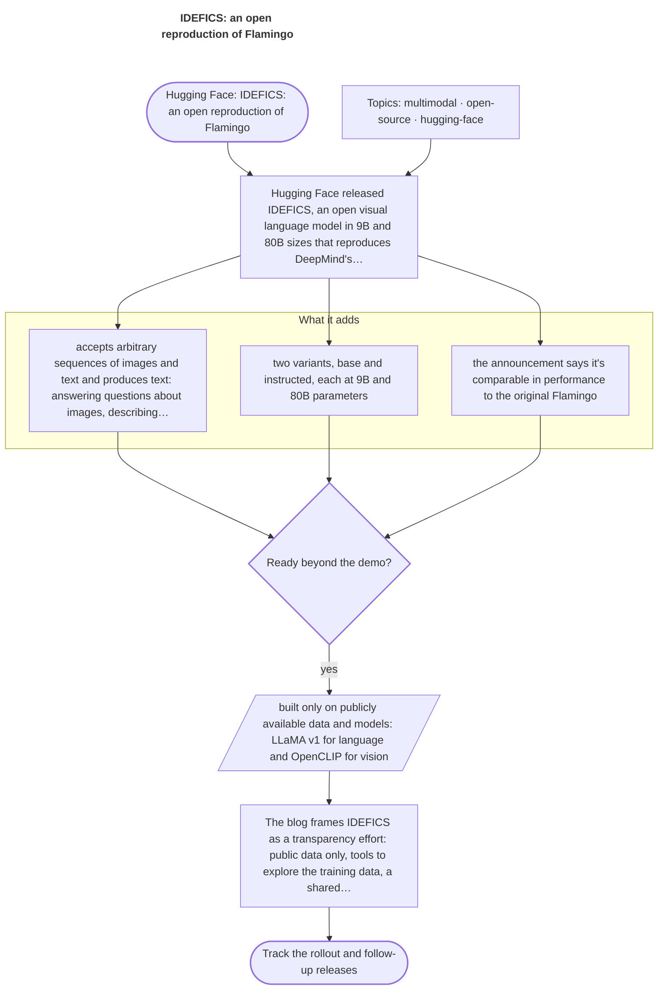

## What happened

Hugging Face released **IDEFICS** (Image-aware Decoder Enhanced à la Flamingo with Interleaved Cross-attentionS), an open-access visual language model. It reproduces **Flamingo**, a DeepMind model that was never publicly released.

## The technical details

- accepts **arbitrary sequences of images and text** and produces text: answering questions about images, describing them, and writing stories grounded in several images
- built only on **publicly available data and models**: LLaMA v1 for language and OpenCLIP for vision
- two variants, **base** and **instructed**, each at **9B** and **80B** parameters
- the announcement says it's comparable in performance to the original Flamingo

## How it fits together

The flowchart below maps this announcement's main points and what depends on them.

## Why it matters

The blog frames IDEFICS as a transparency effort: public data only, tools to explore the training data, a shared log of technical lessons and mistakes, and adversarial red-teaming before release. It joined OpenFlamingo (a 9B reproduction) as an open base for multimodal research at a time when the leading multimodal systems were closed.
