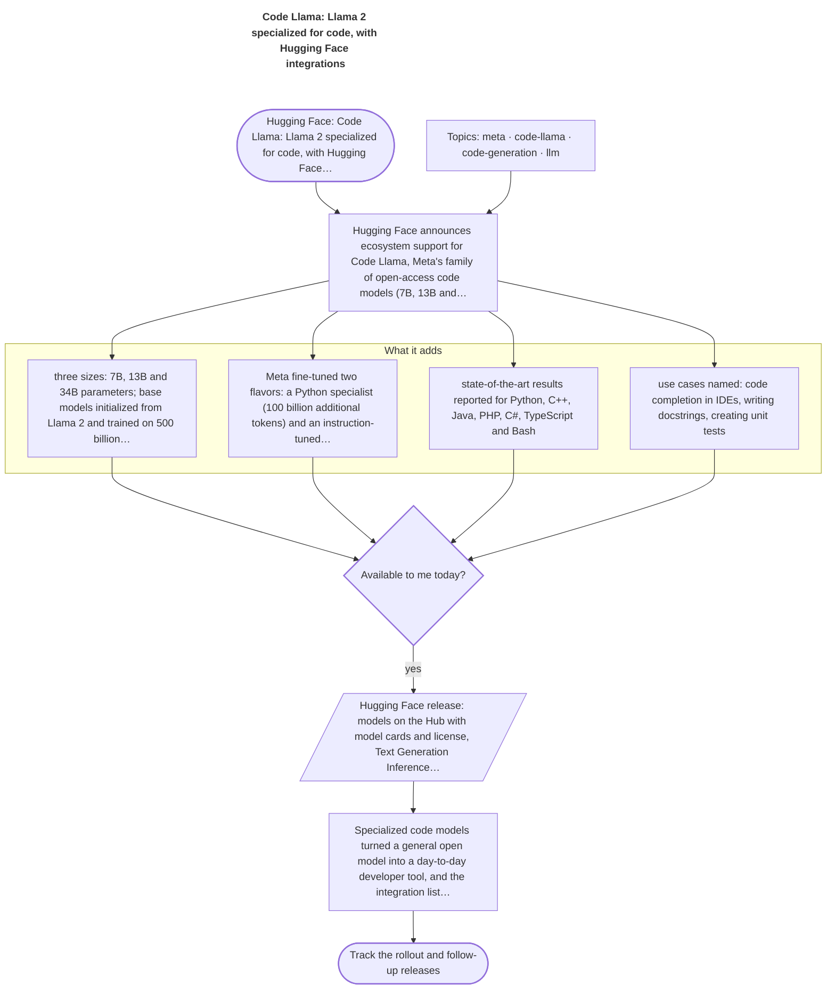

## What happened

On 25 August 2023 **Hugging Face** published its integration of **Code Llama**, a family of state-of-the-art, open-access versions of Llama 2 specialized on code tasks, released with the same permissive community license as Llama 2 and available for commercial use.

## The technical details

From the Hugging Face post:

- three sizes: **7B, 13B and 34B** parameters; base models initialized from Llama 2 and trained on **500 billion tokens of code**
- Meta fine-tuned two flavors: a **Python specialist** (100 billion additional tokens) and an **instruction-tuned** version that understands natural-language instructions
- state-of-the-art results reported for **Python, C++, Java, PHP, C#, TypeScript and Bash**
- Hugging Face release: **models on the Hub** with model cards and license, **Text Generation Inference** support, **Inference Endpoints** and a **VS Code extension**
- use cases named: code completion in IDEs, writing docstrings, creating unit tests

## How it fits together

The flowchart below maps this announcement's main points and what depends on them.

## Why it matters

Specialized code models turned a general open model into a day-to-day developer tool, and the integration list shows what makes a release usable: weights, a serving stack and an editor plugin on the same day.
