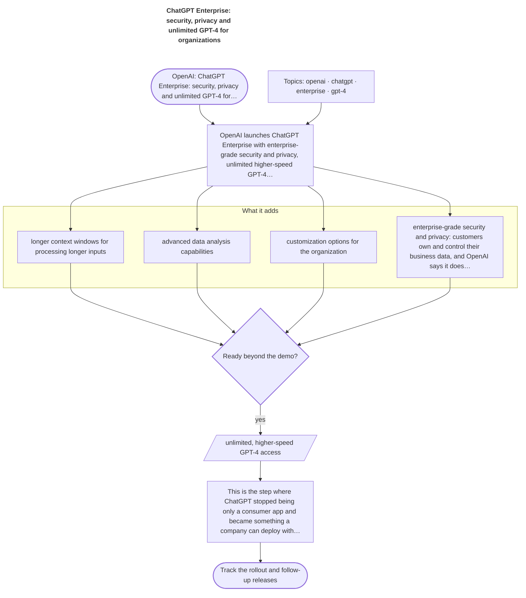

## What happened

**OpenAI** launched **ChatGPT Enterprise** on 28 August 2023, a version of ChatGPT for organizations that want stronger security and privacy controls. Early users named in the announcement included Block, Canva, Carlyle, The Estée Lauder Companies, PwC and Zapier.

## The technical details

From the OpenAI post:

- unlimited, higher-speed **GPT-4** access
- **longer context windows** for processing longer inputs
- **advanced data analysis** capabilities
- customization options for the organization
- **enterprise-grade security and privacy**: customers own and control their business data, and OpenAI says it does not train on it

## How it fits together

The flowchart below maps this announcement's main points and what depends on them.

## Why it matters

This is the step where ChatGPT stopped being only a consumer app and became something a company can deploy with data controls. The post frames the demand directly: teams in over 80% of Fortune 500 companies had already adopted ChatGPT, and business leaders wanted a simple and safe way to roll it out.
