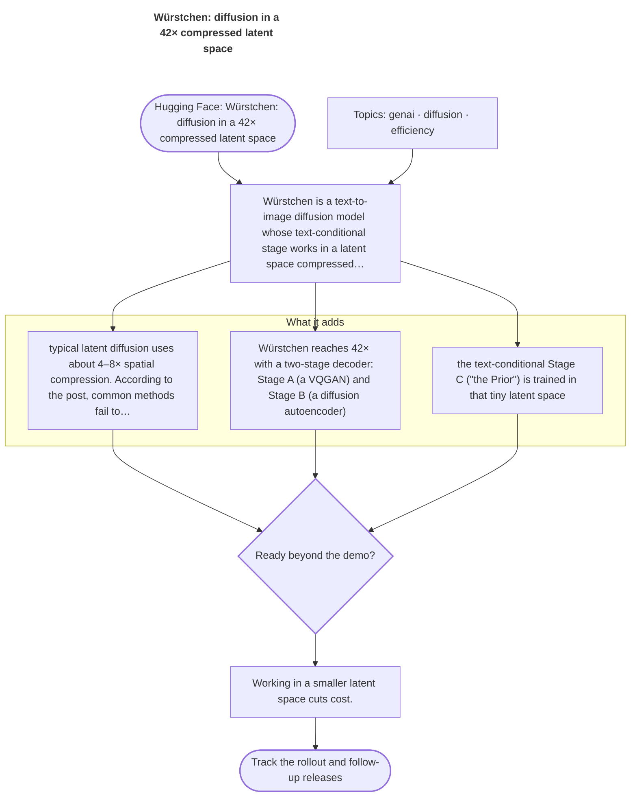

## What happened

**Würstchen**, a diffusion model for text-to-image generation, was integrated into Hugging Face Diffusers, with a blog post explaining its design.

## The technical details

The idea is extreme compression:

- typical latent diffusion uses about **4–8×** spatial compression. According to the post, common methods fail to reconstruct detailed images beyond 16×.
- Würstchen reaches **42×** with a two-stage **decoder**: **Stage A** (a VQGAN) and **Stage B** (a diffusion autoencoder)
- the text-conditional **Stage C** ("the Prior") is trained in that tiny latent space

## How it fits together

The flowchart below maps this announcement's main points and what depends on them.

## Why it matters

Working in a smaller latent space cuts cost. The post reports:

- **v1** (512×512) trained in about **9,000 GPU hours**, versus **150,000** for Stable Diffusion 1.4, a 16× reduction
- **v2** used **24,602 GPU hours** for resolutions up to 1536, still about 6× cheaper than SD 1.4
- faster generation with less memory than SDXL

This is the same latent-diffusion idea as Stable Diffusion (my July 2026 study post traces SD's 48× smaller latent), pushed much further.
