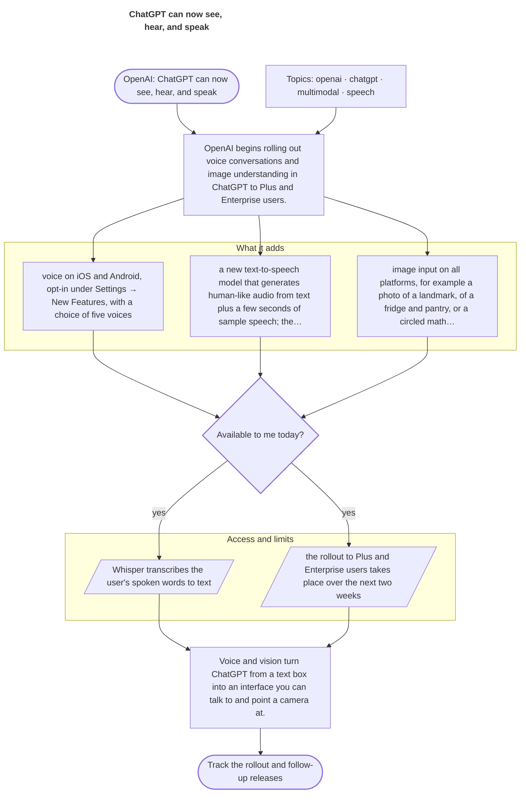

## What happened

On 25 September 2023 **OpenAI** announced voice and image capabilities for **ChatGPT**, rolling out to Plus and Enterprise users over the following two weeks. Users can hold a back-and-forth voice conversation, or show ChatGPT a picture of what they are talking about.

## The technical details

From the OpenAI post:

- **voice** on iOS and Android, opt-in under Settings → New Features, with a choice of five voices
- a new **text-to-speech model** that generates human-like audio from text plus a few seconds of sample speech; the voices were created with professional voice actors
- **Whisper** transcribes the user's spoken words to text
- **image input** on all platforms, for example a photo of a landmark, of a fridge and pantry, or a circled math problem
- the rollout to Plus and Enterprise users takes place over the next two weeks

## How it fits together

The flowchart below maps this announcement's main points and what depends on them.

## Why it matters

Voice and vision turn ChatGPT from a text box into an interface you can talk to and point a camera at. Notably, the voice feature is built as a pipeline of separate models (speech recognition, the language model, text-to-speech), which is the design GPT-4o later replaced with one end-to-end model.
