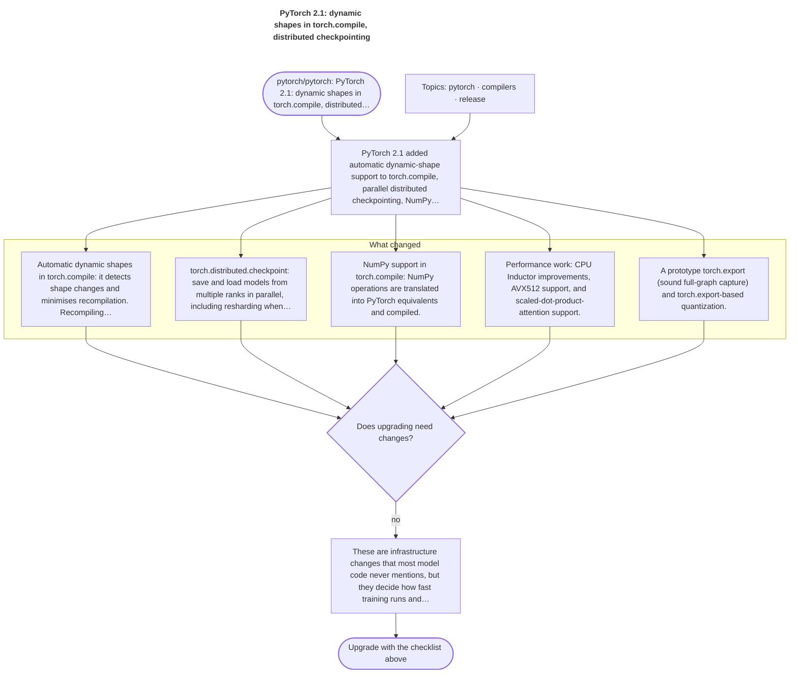

## What happened

**PyTorch 2.1** was released, with 6,682 commits from 784 contributors since 2.0.

## The technical details

From the release notes:

- **Automatic dynamic shapes** in `torch.compile`: it detects shape changes and minimises recompilation. Recompiling for every new batch or sequence length was a practical pain point of 2.0.
- **`torch.distributed.checkpoint`**: save and load models from **multiple ranks in parallel**, including **resharding** when the cluster topology changes.
- **NumPy support** in `torch.compile`: NumPy operations are translated into PyTorch equivalents and compiled.
- Performance work: CPU Inductor improvements, AVX512 support, and scaled-dot-product-attention support.
- A **prototype `torch.export`** (sound full-graph capture) and `torch.export`-based quantization.

## How it fits together

The flowchart below maps this announcement's main points and what depends on them.

## Why it matters

These are infrastructure changes that most model code never mentions, but they decide how fast training runs and how easily large jobs recover. Dynamic shapes in particular made `torch.compile` practical for variable-length text.
