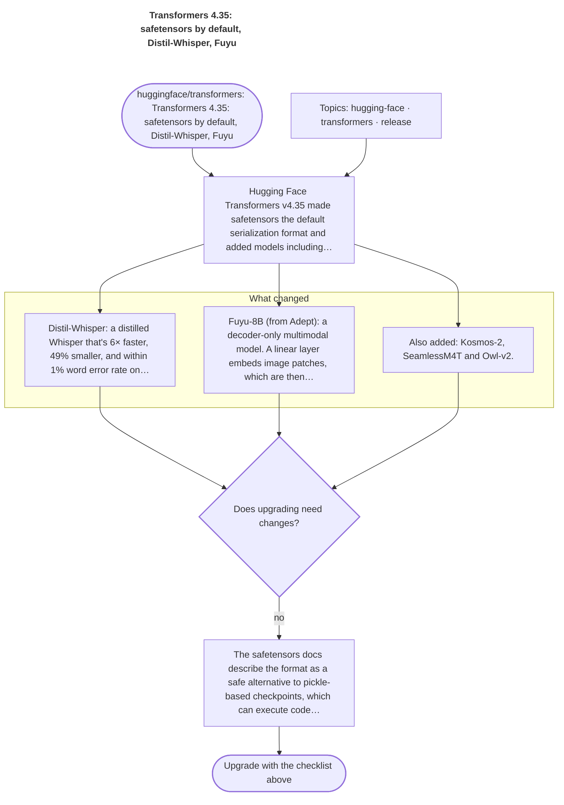

## What happened

**Transformers v4.35.0** switched to **safetensors** as the default way to save models and added several new models.

## The technical details

From the release notes:

- **Distil-Whisper**: a distilled Whisper that's **6× faster**, **49% smaller**, and within **1% word error rate** on out-of-distribution data. It copies Whisper's entire **encoder**, keeping its robustness, but only **2 decoder layers**, which speeds up token-by-token generation. It's MIT licensed, with Flash Attention 2 and speculative decoding support.
- **Fuyu-8B** (from Adept): a **decoder-only** multimodal model. A linear layer embeds image patches, which are then treated **like text tokens**, with a special image-newline token marking row ends.
- Also added: Kosmos-2, SeamlessM4T and Owl-v2.

## How it fits together

The flowchart below maps this announcement's main points and what depends on them.

## Why it matters

The safetensors docs describe the format as a safe alternative to pickle-based checkpoints, which can execute code when loaded. Making it the default is a security improvement for everyone downloading models. I ran into the same issue during my NLP phase, when a pickle-format model download was blocked and I switched to plain-text GloVe vectors.
