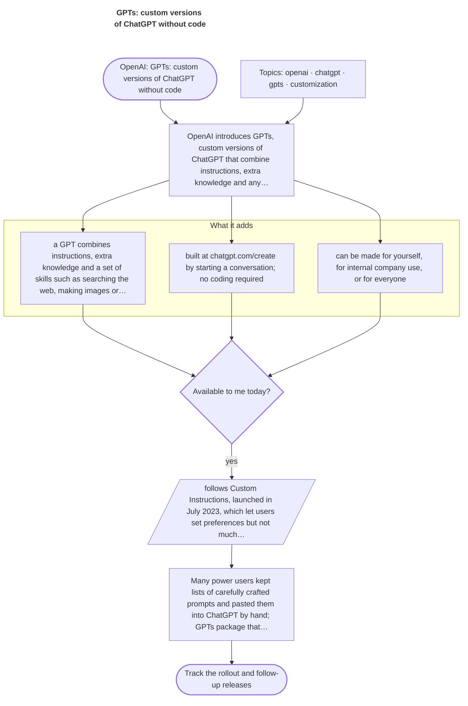

## What happened

On 6 November 2023 **OpenAI** introduced **GPTs**, a way for anyone to create a tailored version of ChatGPT for a specific task and share it. Example GPTs from Canva and Zapier AI Actions were available the same day to ChatGPT Plus and Enterprise users, with more users to follow.

## The technical details

From the OpenAI post:

- a GPT combines **instructions**, **extra knowledge** and a set of **skills** such as searching the web, making images or analyzing data
- built at chatgpt.com/create by starting a conversation; **no coding** required
- can be made for yourself, for internal company use, or for everyone
- follows **Custom Instructions**, launched in July 2023, which let users set preferences but not much more

## How it fits together

The flowchart below maps this announcement's main points and what depends on them.

## Why it matters

Many power users kept lists of carefully crafted prompts and pasted them into ChatGPT by hand; GPTs package that work into something reusable and shareable. The announcement was made alongside OpenAI's DevDay releases of new models and developer products.
