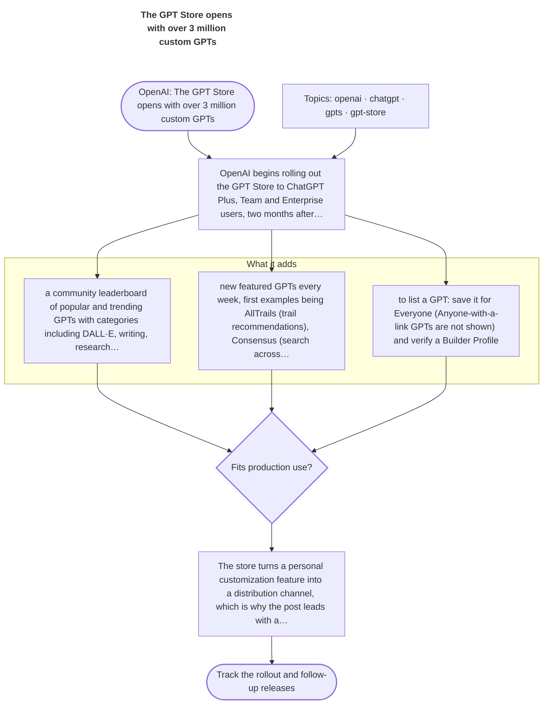

## What happened

On 10 January 2024 **OpenAI** announced the **GPT Store**, a place to find useful and popular custom versions of ChatGPT. It started rolling out to ChatGPT Plus, Team and Enterprise users, two months after GPTs were introduced.

## The technical details

From the OpenAI post:

- a **community leaderboard** of popular and trending GPTs with categories including DALL·E, writing, research, programming, education and lifestyle
- **new featured GPTs every week**, first examples being AllTrails (trail recommendations), Consensus (search across 200M academic papers), Khan Academy's Code Tutor, Canva, Books and the CK-12 Flexi AI tutor
- to list a GPT: save it for **Everyone** (Anyone-with-a-link GPTs are not shown) and verify a **Builder Profile**

## How it fits together

The flowchart below maps this announcement's main points and what depends on them.

## Why it matters

The store turns a personal customization feature into a distribution channel, which is why the post leads with a number: more than 3 million GPTs had been built in just two months, many of them shared.
