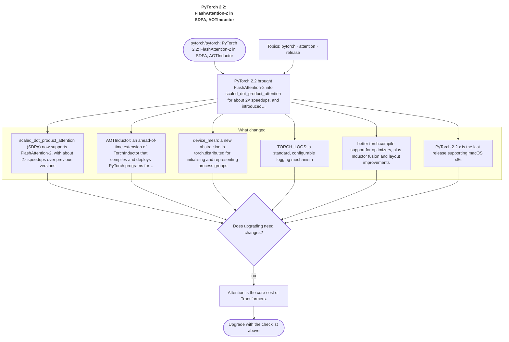

## What happened

**PyTorch 2.2** was released, with 3,628 commits from 521 contributors since 2.1.

## The technical details

From the release notes:

- **`scaled_dot_product_attention` (SDPA)** now supports **FlashAttention-2**, with about **2× speedups** over previous versions
- **AOTInductor**: an ahead-of-time extension of TorchInductor that compiles and deploys PyTorch programs for **non-Python, server-side** environments
- **`device_mesh`**: a new abstraction in `torch.distributed` for initialising and representing process groups
- **`TORCH_LOGS`**: a standard, configurable logging mechanism
- better `torch.compile` support for **optimizers**, plus Inductor fusion and layout improvements
- PyTorch 2.2.x is the **last release supporting macOS x86**

## How it fits together

The flowchart below maps this announcement's main points and what depends on them.

## Why it matters

Attention is the core cost of Transformers. In my self-attention study post I checked my hand-written attention against `F.scaled_dot_product_attention`. That's the same function, and releases like this make it faster without any code change.
