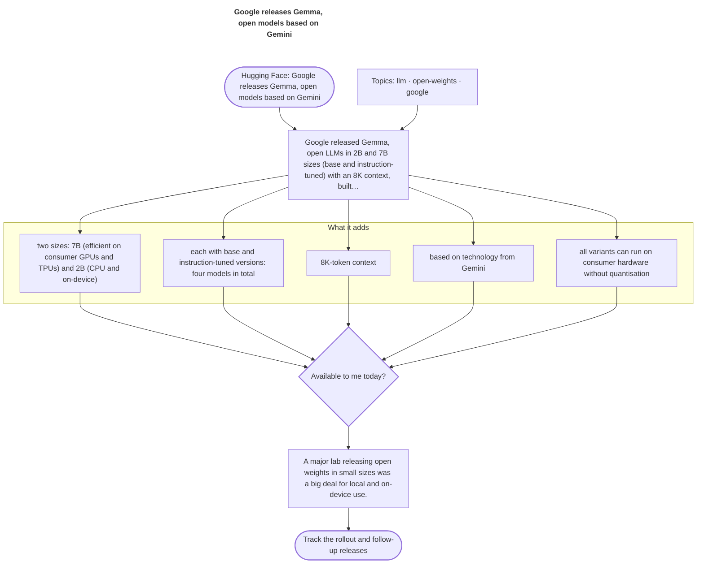

## What happened

**Google** released **Gemma**, a family of open LLMs. Hugging Face announced the integration: models on the Hub, Transformers v4.38, Google Cloud and Inference Endpoints, and a single-GPU fine-tuning example with TRL.

## The technical details

From the Hugging Face post:

- **two sizes**: **7B** (efficient on consumer GPUs and TPUs) and **2B** (CPU and on-device)
- each with **base** and **instruction-tuned** versions: four models in total
- **8K-token** context
- based on technology from **Gemini**
- all variants can run on consumer hardware **without quantisation**

## How it fits together

The flowchart below maps this announcement's main points and what depends on them.

## Why it matters

A major lab releasing open weights in small sizes was a big deal for local and on-device use. Gemma later grew into several generations (Gemma 2, 3, 3n and 4 appear in later posts here).
