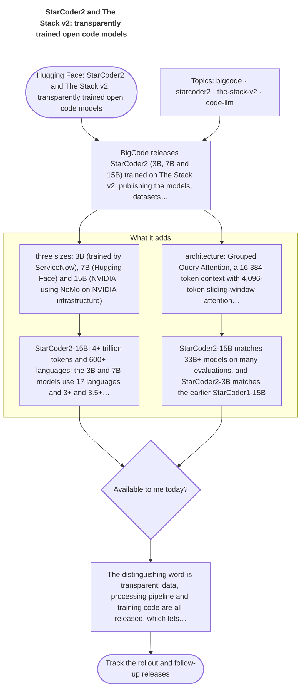

## What happened

On 28 February 2024 **BigCode** released **StarCoder2**, the next generation of transparently trained open code LLMs, trained on **The Stack v2**, a new large, high-quality code dataset. All models, datasets, processing and training code were released.

## The technical details

From the Hugging Face post:

- three sizes: **3B** (trained by ServiceNow), **7B** (Hugging Face) and **15B** (NVIDIA, using NeMo on NVIDIA infrastructure)
- **StarCoder2-15B:** 4+ trillion tokens and **600+ languages**; the 3B and 7B models use 17 languages and 3+ and 3.5+ trillion tokens
- architecture: **Grouped Query Attention**, a **16,384-token** context with **4,096-token sliding-window attention**, trained with the **Fill-in-the-Middle** objective
- StarCoder2-15B matches **33B+ models** on many evaluations, and StarCoder2-3B matches the earlier StarCoder1-15B

## How it fits together

The flowchart below maps this announcement's main points and what depends on them.

## Why it matters

The distinguishing word is transparent: data, processing pipeline and training code are all released, which lets others reproduce or audit the model, not just use it. Sliding-window attention inside a 16K context is also a design that later open models adopted.
