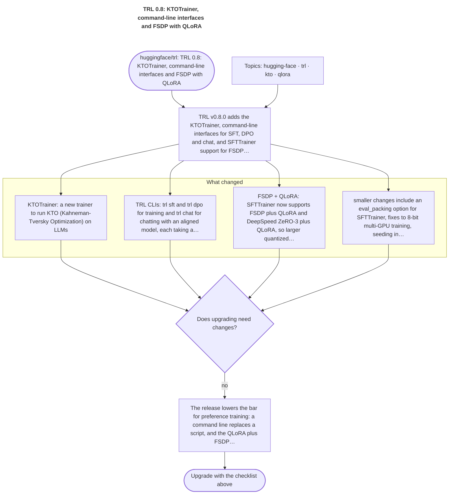

## What happened

On 19 March 2024 the **Hugging Face TRL** library released **v0.8.0**, its post-training toolkit for aligning language models, with three headline changes.

## The technical details

From the release notes:

- **KTOTrainer:** a new trainer to run KTO (Kahneman-Tversky Optimization) on LLMs
- **TRL CLIs:** `trl sft` and `trl dpo` for training and `trl chat` for chatting with an aligned model, each taking a model name or path and a dataset
- **FSDP + QLoRA:** `SFTTrainer` now supports **FSDP plus QLoRA** and **DeepSpeed ZeRO-3 plus QLoRA**, so larger quantized models can be fine-tuned across several GPUs
- smaller changes include an `eval_packing` option for `SFTTrainer`, fixes to 8-bit multi-GPU training, seeding in SFT, DPO and reward modeling for reproducibility, and arguments for XPU support

## How it fits together

The flowchart below maps this announcement's main points and what depends on them.

## Why it matters

The release lowers the bar for preference training: a command line replaces a script, and the QLoRA plus FSDP combination is what lets large models be tuned on modest hardware. This blog's study notes cover KTO, DPO and QLoRA in the LLM alignment phase.
