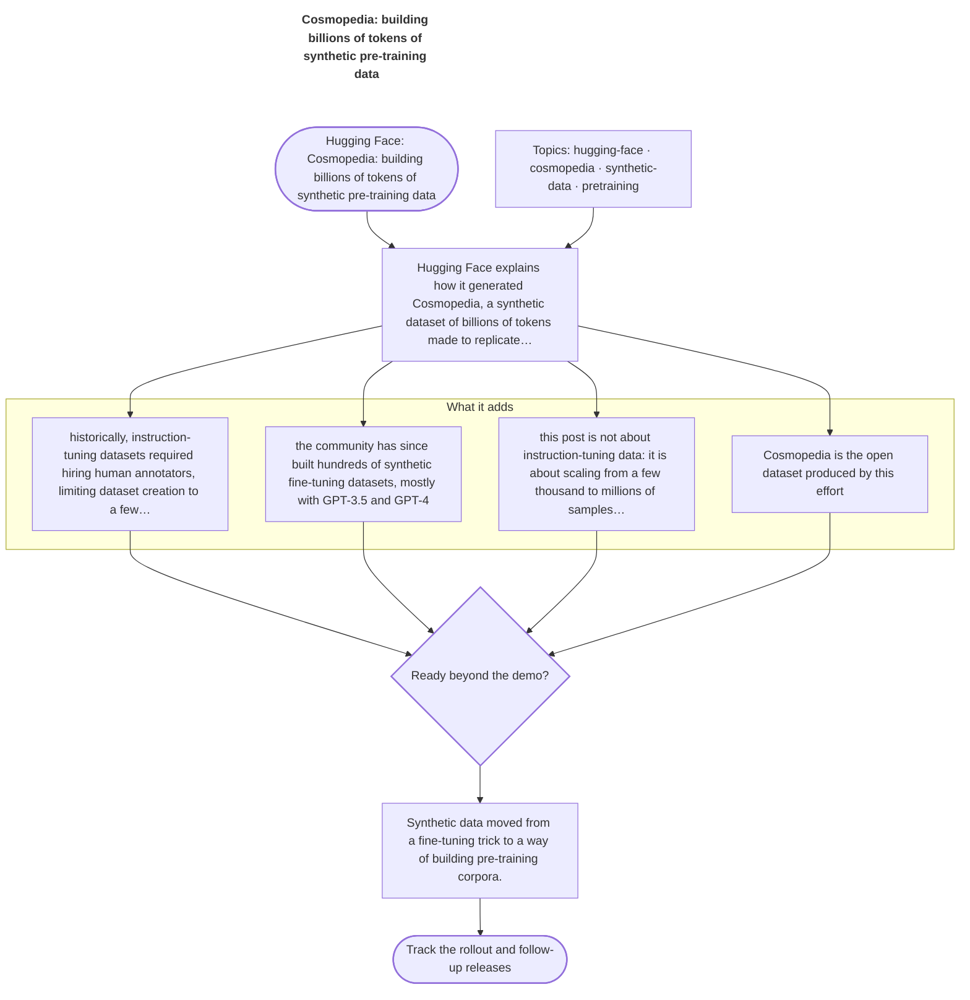

## What happened

On 20 March 2024 **Hugging Face** described the challenges and solutions behind **Cosmopedia**, a synthetic dataset with billions of tokens created to replicate Phi-1.5. Synthetic data means data artificially generated, for instance by LLMs, to mimic real-world data.

## The technical details

From the Hugging Face post:

- historically, instruction-tuning datasets required **hiring human annotators**, limiting dataset creation to a few players
- the community has since built hundreds of synthetic fine-tuning datasets, mostly with **GPT-3.5 and GPT-4**
- this post is **not about instruction-tuning data**: it is about scaling from a few thousand to **millions of samples for pre-training LLMs from scratch**, which raises distinct challenges
- Cosmopedia is the open dataset produced by this effort

## How it fits together

The flowchart below maps this announcement's main points and what depends on them.

## Why it matters

Synthetic data moved from a fine-tuning trick to a way of building pre-training corpora. Publishing the recipe is the useful part, because the Phi results were hard to study without knowing how the data was made. This blog's study notes cover the technique under synthetic data for pre-training.
