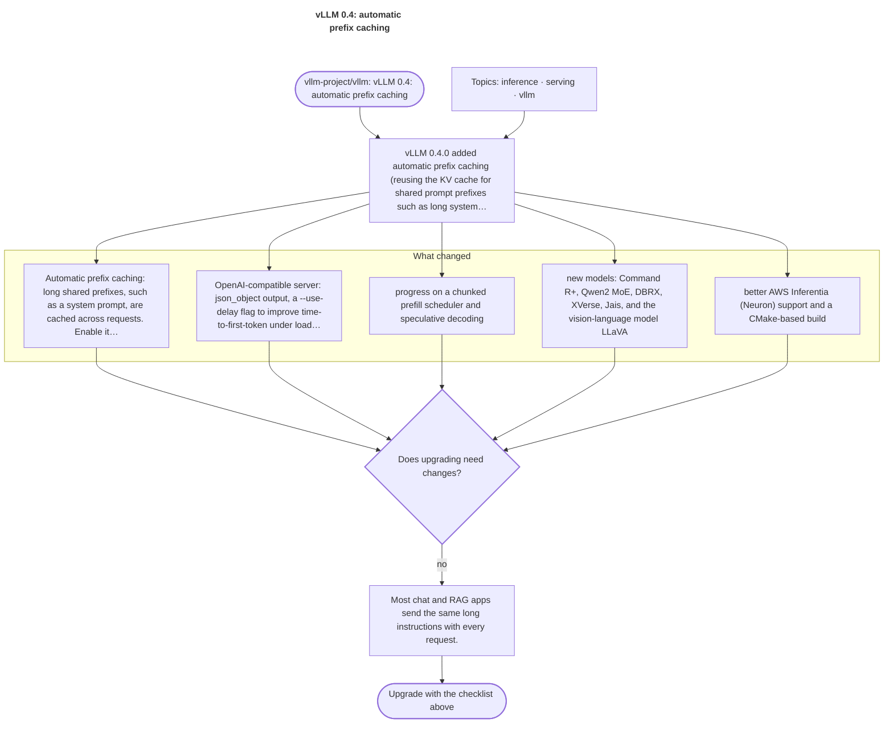

## What happened

**vLLM v0.4.0**, an open-source LLM serving engine, was released.

## The technical details

From the release notes:

- **Automatic prefix caching**: long shared prefixes, such as a system prompt, are cached across requests. Enable it with `--enable-prefix-caching`.
- OpenAI-compatible server: `json_object` output, a `--use-delay` flag to improve time-to-first-token under load, and `min_tokens`.
- progress on a **chunked prefill** scheduler and **speculative decoding**
- new models: Command R+, Qwen2 MoE, DBRX, XVerse, Jais, and the vision-language model **LLaVA**
- better AWS Inferentia (Neuron) support and a CMake-based build

## How it fits together

The flowchart below maps this announcement's main points and what depends on them.

## Why it matters

Most chat and RAG apps send the same long instructions with every request. Without caching, the model recomputes attention keys and values for that text every time. Prefix caching skips that repeated work, which directly cuts latency and cost.
