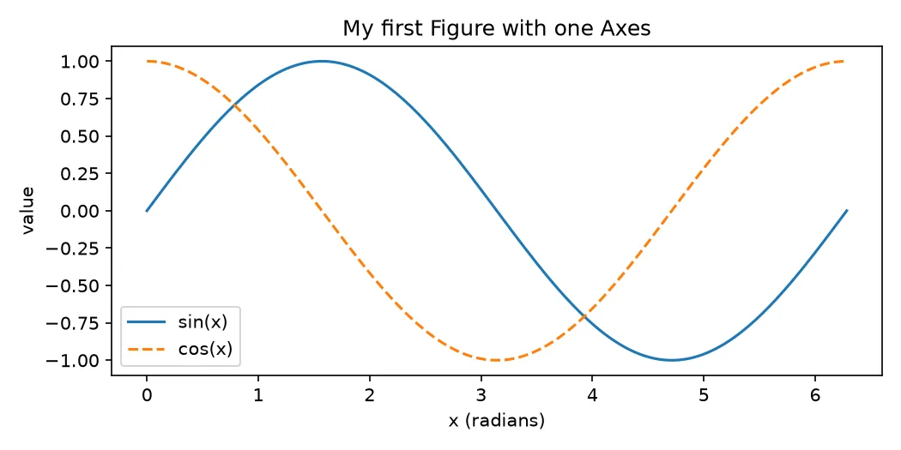

Matplotlib has two interfaces:

- **pyplot (implicit)**: `plt.plot(...)`, `plt.title(...)`. It acts on "the current axes", which gets confusing once there's more than one plot.
- **Object-oriented (explicit)**: `fig, ax = plt.subplots()` and then `ax.plot(...)`, `ax.set_title(...)`. Matplotlib's quick-start guide recommends this style for anything non-trivial, and I'm using it from now on.

The pieces: a **Figure** is the canvas. An **Axes** is one plot area, with an x **Axis** and a y **Axis** that have ticks and labels. One figure can hold many Axes.

```python run
import os
import numpy as np
import matplotlib.pyplot as plt

x = np.linspace(0, 2 * np.pi, 200)
fig, ax = plt.subplots(figsize=(7, 3.5), dpi=150)
ax.plot(x, np.sin(x), label="sin(x)")
ax.plot(x, np.cos(x), label="cos(x)", linestyle="--")
ax.set_title("My first Figure with one Axes")
ax.set_xlabel("x (radians)")
ax.set_ylabel("value")
ax.legend()
fig.tight_layout()
fig.savefig(os.environ["SNIPPET_FIG"])

print(type(fig).__name__, type(ax).__name__)
print("axes in figure:", len(fig.axes), "| lines on ax:", len(ax.lines))
print("x-limits:", tuple(round(v, 2) for v in ax.get_xlim()))
```

Output:

```text
Figure Axes
axes in figure: 1 | lines on ax: 2
x-limits: (np.float64(-0.31), np.float64(6.6))
```


