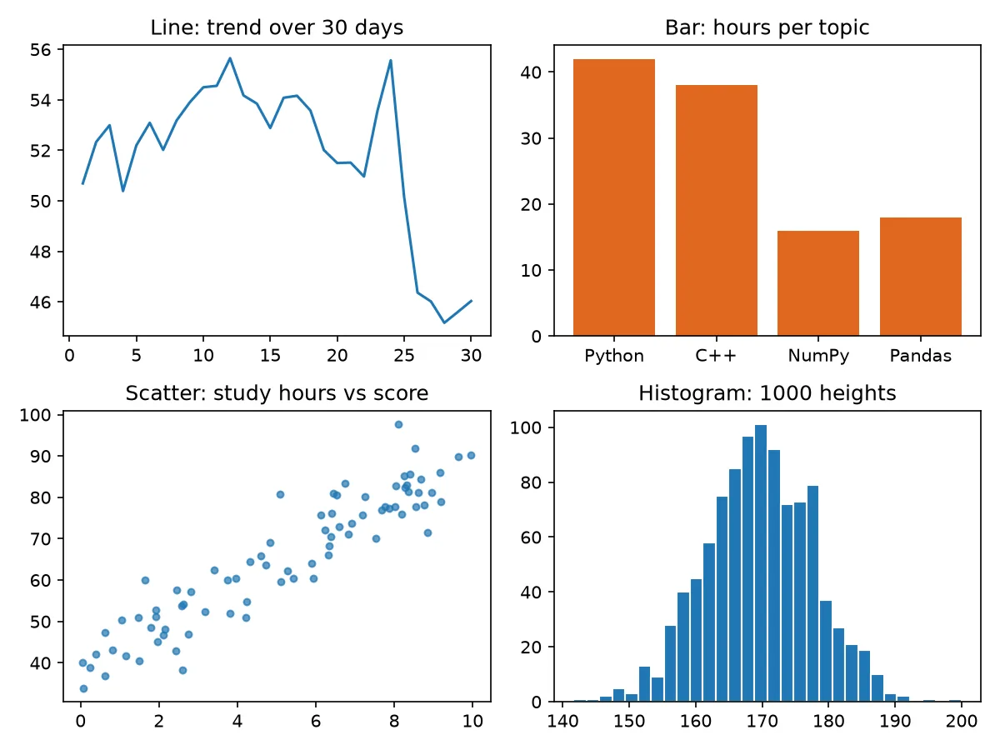

How I'm choosing a chart, starting from the question:

| question | chart | call |
|---|---|---|
| how does it change over time? | line | `ax.plot` |
| how do categories compare? | bar | `ax.bar` / `ax.barh` |
| are two variables related? | scatter | `ax.scatter` |
| how are values distributed? | histogram | `ax.hist` |

With histograms, the **number of bins** changes the picture, so it's worth trying a few values.

```python run
import os
import numpy as np
import matplotlib.pyplot as plt

rng = np.random.default_rng(1)
fig, axs = plt.subplots(2, 2, figsize=(8, 6), dpi=150)

days = np.arange(1, 31)
axs[0, 0].plot(days, 50 + np.cumsum(rng.normal(0, 2, 30)))
axs[0, 0].set_title("Line: trend over 30 days")

subjects = ["Python", "C++", "NumPy", "Pandas"]
hours = [42, 38, 16, 18]
axs[0, 1].bar(subjects, hours, color="#e0681f")
axs[0, 1].set_title("Bar: hours per topic")

study = rng.uniform(0, 10, 80)
score = 40 + 5 * study + rng.normal(0, 6, 80)
axs[1, 0].scatter(study, score, s=14, alpha=0.7)
axs[1, 0].set_title("Scatter: study hours vs score")

axs[1, 1].hist(rng.normal(170, 8, 1000), bins=30, edgecolor="white")
axs[1, 1].set_title("Histogram: 1000 heights")

fig.tight_layout()
fig.savefig(os.environ["SNIPPET_FIG"])
print("correlation study/score:", round(np.corrcoef(study, score)[0, 1], 3))
print("panels:", [a.get_title().split(":")[0] for a in axs.ravel()])
```

Output:

```text
correlation study/score: 0.932
panels: ['Line', 'Bar', 'Scatter', 'Histogram']
```


