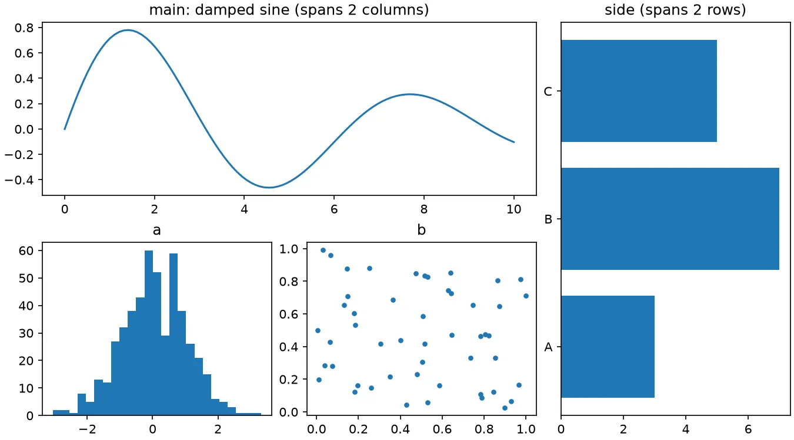

- `plt.subplots(nrows, ncols)` returns a figure and a 2-D array of Axes.
- `sharex=True` / `sharey=True` put the panels on the **same scale**, so they can be compared honestly.
- `layout="constrained"` (or `tight_layout()`) stops labels from overlapping.
- For uneven layouts, `plt.subplot_mosaic` lets you *draw* the layout with letters. Repeating a letter makes that panel span several cells.

```python run
import os
import numpy as np
import matplotlib.pyplot as plt

rng = np.random.default_rng(3)
x = np.linspace(0, 10, 100)

fig, axd = plt.subplot_mosaic(
    [["main", "main", "side"],
     ["a",    "b",    "side"]],
    figsize=(9, 5), dpi=150, layout="constrained",
)
axd["main"].plot(x, np.sin(x) * np.exp(-x / 6))
axd["main"].set_title("main: damped sine (spans 2 columns)")
axd["side"].barh(["A", "B", "C"], [3, 7, 5])
axd["side"].set_title("side (spans 2 rows)")
axd["a"].hist(rng.normal(size=500), bins=25)
axd["a"].set_title("a")
axd["b"].scatter(rng.random(50), rng.random(50), s=10)
axd["b"].set_title("b")
fig.savefig(os.environ["SNIPPET_FIG"])

fig2, axs = plt.subplots(1, 3, sharey=True)
print("panels:", sorted(axd), "| shared-y grid shape:", axs.shape)
```

Output:

```text
panels: ['a', 'b', 'main', 'side'] | shared-y grid shape: (3,)
```


