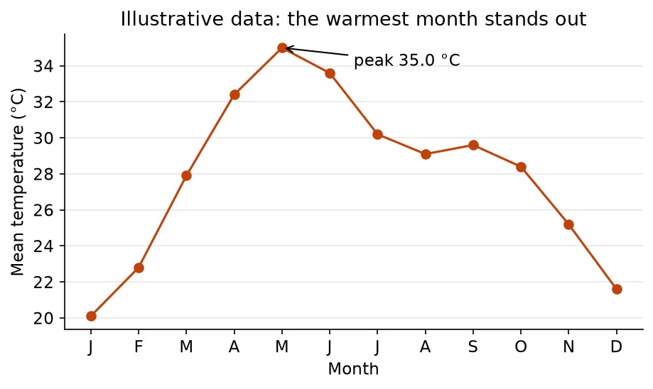

My styling checklist from today:

1. **Axis labels with units** (`"Temperature (°C)"`).
2. **A title that states the finding**, not just the variable names.
3. **Remove chart junk**: hide the top and right spines, and use light grid lines.
4. **Annotate** the one point that matters with `ax.annotate`.
5. Use **perceptually uniform colormaps** like `viridis` for continuous data. The Matplotlib docs explain why `jet` misleads.
6. Save at a sensible DPI and call `bbox_inches="tight"`.

`rcParams` and style sheets (`plt.style.use(...)`) change the defaults everywhere at once.

```python run
import os
import numpy as np
import matplotlib.pyplot as plt

plt.rcParams.update({"font.size": 11, "axes.spines.top": False, "axes.spines.right": False})

months = np.arange(1, 13)
temp = np.array([20.1, 22.8, 27.9, 32.4, 35.0, 33.6, 30.2, 29.1, 29.6, 28.4, 25.2, 21.6])  # illustrative values
fig, ax = plt.subplots(figsize=(7, 3.6), dpi=150)
ax.plot(months, temp, marker="o", color="#c2410c")
ax.grid(axis="y", alpha=0.3)
ax.set_xticks(months, ["J", "F", "M", "A", "M", "J", "J", "A", "S", "O", "N", "D"])
ax.set_xlabel("Month")
ax.set_ylabel("Mean temperature (°C)")
ax.set_title("Illustrative data: the warmest month stands out")
peak = temp.argmax()
ax.annotate(f"peak {temp[peak]} °C", xy=(months[peak], temp[peak]),
            xytext=(months[peak] + 1.5, temp[peak] - 1), arrowprops={"arrowstyle": "->"})
fig.savefig(os.environ["SNIPPET_FIG"], bbox_inches="tight")

print("available styles include ggplot:", "ggplot" in plt.style.available)
print("peak month index:", int(months[peak]))
```

Output:

```text
available styles include ggplot: True
peak month index: 5
```



The temperatures here are made-up practice numbers, not real weather data.
