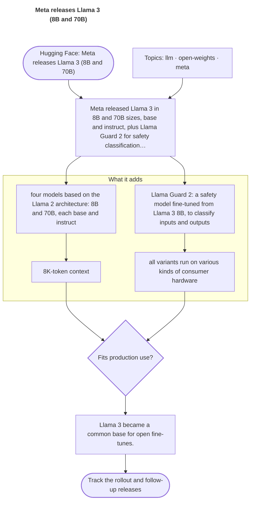

## What happened

**Meta** released **Llama 3**, and Hugging Face integrated it: models on the Hub, Transformers support, HuggingChat for the 70B instruct model, deployment on Inference Endpoints, Google Cloud and SageMaker, and a single-GPU fine-tuning example.

## The technical details

From the Hugging Face post:

- four models based on the **Llama 2 architecture**: **8B** and **70B**, each **base** and **instruct**
- **8K-token** context
- **Llama Guard 2**: a safety model fine-tuned from Llama 3 8B, to classify inputs and outputs
- all variants run on various kinds of consumer hardware

## How it fits together

The flowchart below maps this announcement's main points and what depends on them.

## Why it matters

Llama 3 became a common base for open fine-tunes. Several papers summarised on this blog build on it, for example the trust-region alignment work (April 2024) and Instruction Pre-Training (June 2024).
