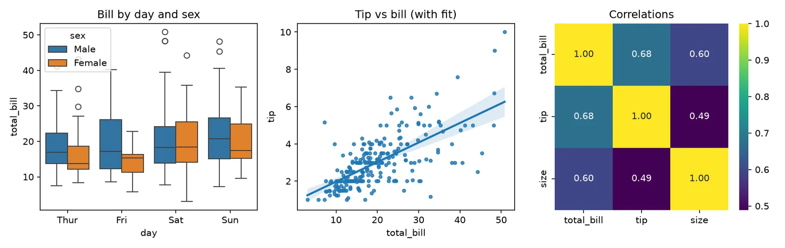

Seaborn is built on Matplotlib and designed for **statistical** plots straight from a DataFrame:

- Pass `data=df, x="col", y="col"` and it uses the column names as labels.
- `hue="category"` colours and splits any plot by a group.
- Useful plots: `boxplot` / `violinplot` (distributions per group), `regplot` (scatter plus a fitted line with a confidence band), `heatmap` (matrices such as correlations).
- Every Seaborn function draws on a Matplotlib Axes (`ax=`), so all the styling from yesterday still applies.

The example uses the `tips` dataset that ships with Seaborn's examples. `load_dataset` downloads it from the seaborn-data repository.

```python run
import os
import matplotlib.pyplot as plt
import seaborn as sns

tips = sns.load_dataset("tips")
print(tips.shape, list(tips.columns))

fig, axs = plt.subplots(1, 3, figsize=(12, 3.8), dpi=150)
sns.boxplot(data=tips, x="day", y="total_bill", hue="sex", ax=axs[0])
axs[0].set_title("Bill by day and sex")
sns.regplot(data=tips, x="total_bill", y="tip", ax=axs[1], scatter_kws={"s": 12})
axs[1].set_title("Tip vs bill (with fit)")
sns.heatmap(tips[["total_bill", "tip", "size"]].corr(), annot=True, fmt=".2f", cmap="viridis", ax=axs[2])
axs[2].set_title("Correlations")
fig.tight_layout()
fig.savefig(os.environ["SNIPPET_FIG"])

print(tips.groupby("day", observed=True)["total_bill"].median())
```

Output:

```text
(244, 7) ['total_bill', 'tip', 'sex', 'smoker', 'day', 'time', 'size']
day
Thur    16.20
Fri     15.38
Sat     18.24
Sun     19.63
Name: total_bill, dtype: float64
```


