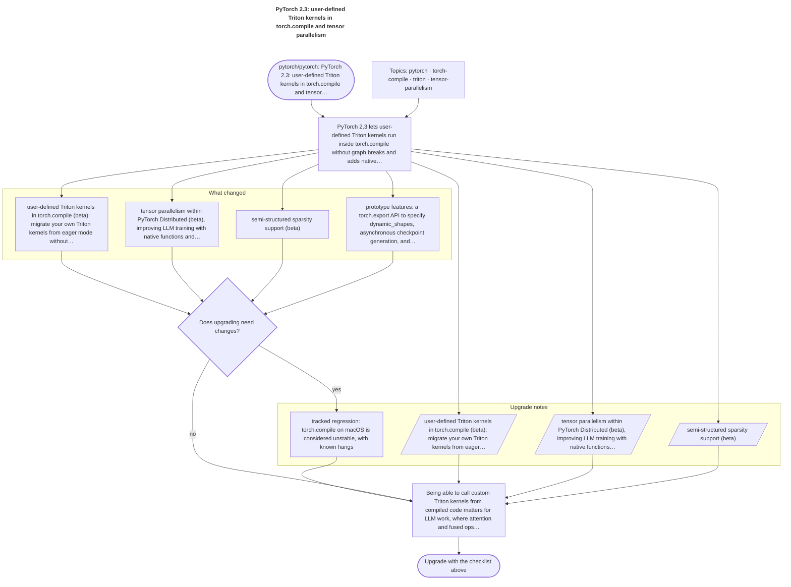

## What happened

On 24 April 2024 the **PyTorch** team released **2.3**. Its two headline features are support for user-defined **Triton kernels** in `torch.compile` and **tensor parallelism** in PyTorch Distributed.

## The technical details

From the release notes:

- **user-defined Triton kernels in torch.compile** (beta): migrate your own Triton kernels from eager mode without performance complications or graph breaks
- **tensor parallelism** within PyTorch Distributed (beta), improving LLM training with native functions and validated on training runs for **100B-parameter models**
- **semi-structured sparsity** support (beta)
- prototype features: a `torch.export` API to specify `dynamic_shapes`, **asynchronous checkpoint generation**, and **weight-only quantization** in the Inductor CPU backend
- tracked regression: `torch.compile` on macOS is considered unstable, with known hangs

## How it fits together

The flowchart below maps this announcement's main points and what depends on them.

## Why it matters

Being able to call custom Triton kernels from compiled code matters for LLM work, where attention and fused ops are often hand-written. It connects to this blog's earlier PyTorch 2.2 and 2.5 posts on SDPA and FlexAttention.
