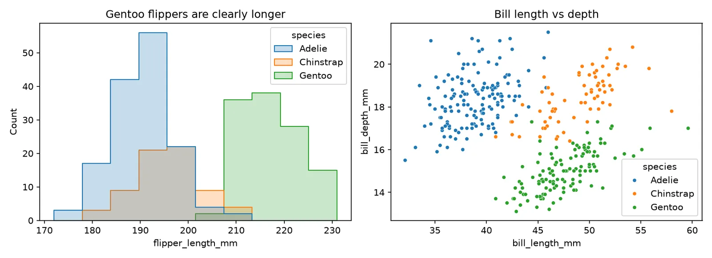

To finish the visualisation phase I did a small exploratory data analysis (EDA) using everything from NumPy, Pandas and Matplotlib. The dataset is **Palmer Penguins** (Horst, Hill and Gorman; CC0), which ships in Seaborn's example data.

My EDA order:

1. Shape, columns and types
2. Missing values
3. One variable at a time (distributions)
4. Groups (by species)
5. Relationships between variables

```python run
import os
import matplotlib.pyplot as plt
import seaborn as sns

df = sns.load_dataset("penguins")
print(df.shape)
print(df.isna().sum().to_dict())
df = df.dropna()
print("after dropna:", df.shape)
print(df["species"].value_counts().to_dict())
print(df.groupby("species")[["bill_length_mm", "flipper_length_mm", "body_mass_g"]].mean().round(1))

fig, axs = plt.subplots(1, 2, figsize=(11, 4), dpi=150)
sns.histplot(data=df, x="flipper_length_mm", hue="species", element="step", ax=axs[0])
axs[0].set_title("Gentoo flippers are clearly longer")
sns.scatterplot(data=df, x="bill_length_mm", y="bill_depth_mm", hue="species", s=18, ax=axs[1])
axs[1].set_title("Bill length vs depth")
fig.tight_layout()
fig.savefig(os.environ["SNIPPET_FIG"])
print("corr(flipper, mass) =", round(df["flipper_length_mm"].corr(df["body_mass_g"]), 3))
```

Output:

```text
(344, 7)
{'species': 0, 'island': 0, 'bill_length_mm': 2, 'bill_depth_mm': 2, 'flipper_length_mm': 2, 'body_mass_g': 2, 'sex': 11}
after dropna: (333, 7)
{'Adelie': 146, 'Gentoo': 119, 'Chinstrap': 68}
           bill_length_mm  flipper_length_mm  body_mass_g
species                                                  
Adelie               38.8              190.1       3706.2
Chinstrap            48.8              195.8       3733.1
Gentoo               47.6              217.2       5092.4
corr(flipper, mass) = 0.873
```



The data is from the Palmer Station LTER, released by Horst, Hill and Gorman as the `palmerpenguins` package. Next phase: probability and statistics, to put numbers behind patterns like these.
