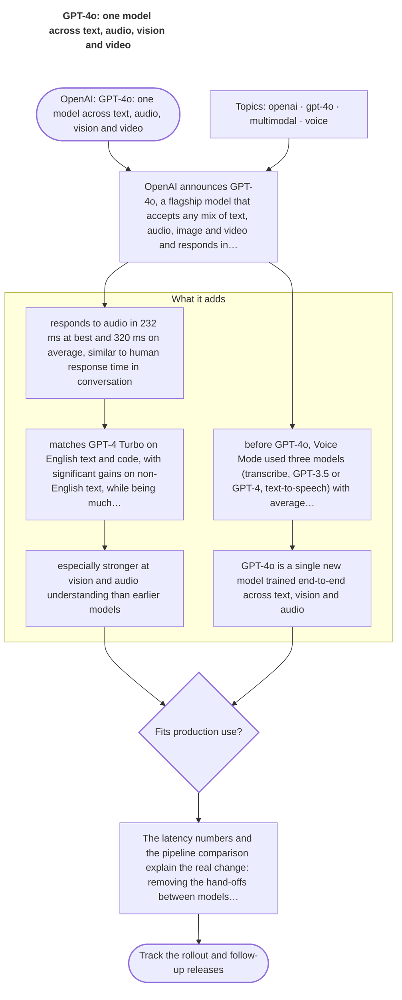

## What happened

On 13 May 2024 **OpenAI** announced **GPT-4o** (the “o” is for “omni”), a step toward more natural human-computer interaction. It accepts text, audio, image and video as input and generates text, audio and image outputs.

## The technical details

From the OpenAI post:

- responds to audio in **232 ms at best and 320 ms on average**, similar to human response time in conversation
- matches **GPT-4 Turbo** on English text and code, with significant gains on non-English text, while being **much faster and 50% cheaper** in the API
- especially stronger at **vision and audio** understanding than earlier models
- before GPT-4o, Voice Mode used three models (transcribe, GPT-3.5 or GPT-4, text-to-speech) with average latencies of **2.8 s** (GPT-3.5) and **5.4 s** (GPT-4), and the middle model could not see tone, multiple speakers or background noise
- GPT-4o is a **single new model trained end-to-end** across text, vision and audio

## How it fits together

The flowchart below maps this announcement's main points and what depends on them.

## Why it matters

The latency numbers and the pipeline comparison explain the real change: removing the hand-offs between models lets the model use information (tone, interruptions, laughter) that a text-only middle stage would discard.
