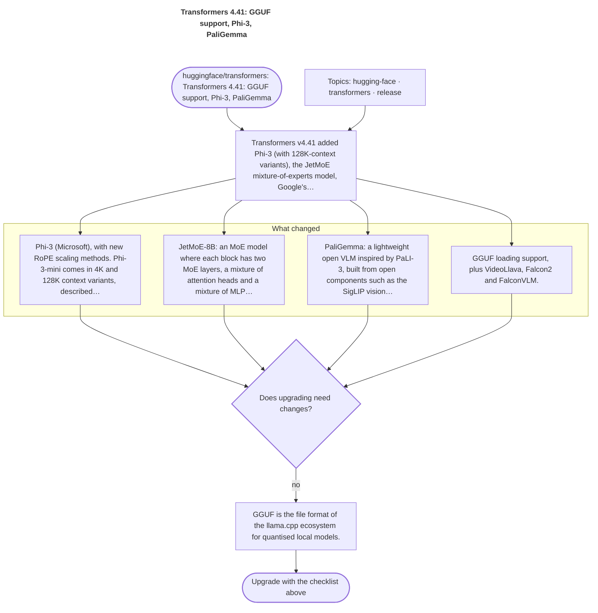

## What happened

**Transformers v4.41.0** added several models and GGUF support.

## The technical details

From the release notes:

- **Phi-3** (Microsoft), with new RoPE scaling methods. Phi-3-mini comes in **4K and 128K** context variants, described as the first in its class to support 128K tokens with little impact on quality. The technical report is summarised here on 23 April 2024.
- **JetMoE-8B**: an MoE model where each block has **two MoE layers**, a mixture of attention heads and a mixture of MLP experts. The notes report training throughput around 100B tokens per day on 96 H100s.
- **PaliGemma**: a lightweight open VLM inspired by PaLI-3, built from open components such as the **SigLIP** vision model.
- **GGUF** loading support, plus VideoLlava, Falcon2 and FalconVLM.

## How it fits together

The flowchart below maps this announcement's main points and what depends on them.

## Why it matters

GGUF is the file format of the llama.cpp ecosystem for quantised local models. Loading it in Transformers connects the two worlds. PaliGemma grew into PaliGemma 2 (summarised here in Dec 2024).
