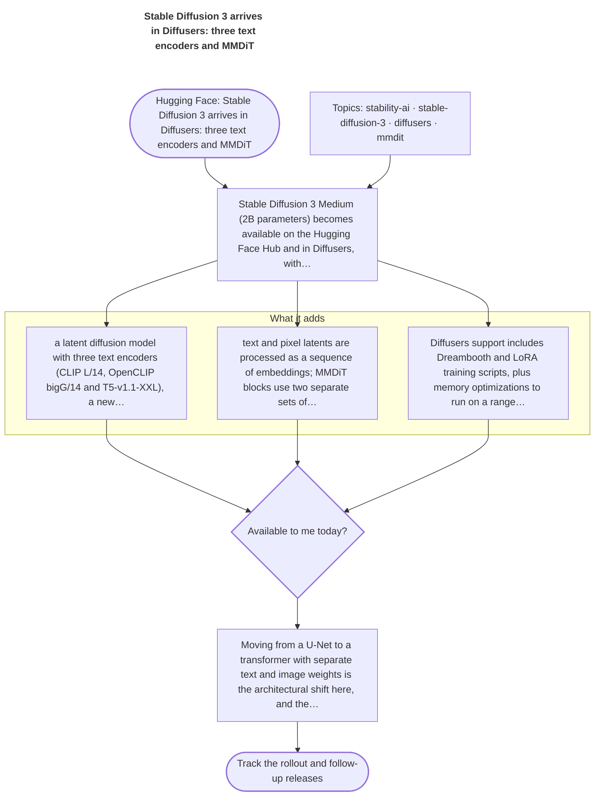

## What happened

On 12 June 2024 **Hugging Face** announced that **Stable Diffusion 3** (Stability AI's latest Stable Diffusion model) is available on the Hub and usable with **Diffusers**. The model released that day is **Stable Diffusion 3 Medium**, with **2B parameters**.

## The technical details

From the Hugging Face post:

- a **latent diffusion** model with **three text encoders** (CLIP L/14, OpenCLIP bigG/14 and T5-v1.1-XXL), a new **Multimodal Diffusion Transformer (MMDiT)** and a **16-channel autoencoder** similar to SDXL's
- text and pixel latents are processed as a sequence of embeddings; **MMDiT blocks use two separate sets of weights** to embed text and image sequences, then join them for attention
- Diffusers support includes **Dreambooth and LoRA training scripts**, plus **memory optimizations** to run on a range of hardware and **performance optimizations**

## How it fits together

The flowchart below maps this announcement's main points and what depends on them.

## Why it matters

Moving from a U-Net to a transformer with separate text and image weights is the architectural shift here, and the memory optimizations matter because three text encoders make the model heavy for consumer GPUs.
