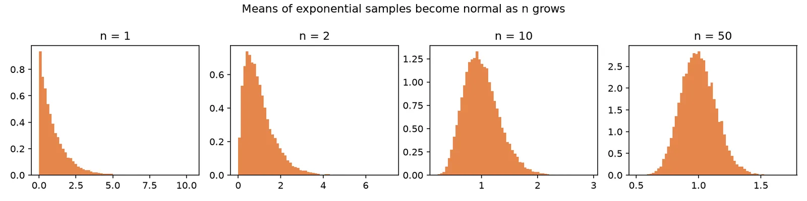

The **Central Limit Theorem**: take many samples of size n from *any* distribution with mean μ and finite standard deviation σ. The sample means are approximately **Normal(μ, σ/√n)**, and the approximation improves as n grows.

Two consequences I'll keep using:

1. Confidence intervals and many tests work on means even when the data itself is skewed.
2. The **standard error** σ/√n means that quadrupling the sample size only halves the uncertainty.

To test it, I drew from an exponential distribution, which is heavily skewed. I tracked the skewness of the sample means as n grows, since 0 means symmetric like a normal distribution.

```python run
import os
import numpy as np
import matplotlib.pyplot as plt
from scipy import stats

rng = np.random.default_rng(3)
fig, axs = plt.subplots(1, 4, figsize=(12, 3), dpi=150, sharey=False)
for ax, n in zip(axs, [1, 2, 10, 50]):
    means = rng.exponential(scale=1.0, size=(20_000, n)).mean(axis=1)
    ax.hist(means, bins=60, density=True, color="#e0681f", alpha=0.8)
    ax.set_title(f"n = {n}")
    print(f"n={n:>2}: mean {means.mean():.3f}, sd {means.std():.3f} (theory {1 / np.sqrt(n):.3f}), skew {stats.skew(means):.2f}")
fig.suptitle("Means of exponential samples become normal as n grows")
fig.tight_layout()
fig.savefig(os.environ["SNIPPET_FIG"])
```

Output:

```text
n= 1: mean 0.998, sd 0.989 (theory 1.000), skew 1.97
n= 2: mean 1.001, sd 0.715 (theory 0.707), skew 1.43
n=10: mean 1.003, sd 0.319 (theory 0.316), skew 0.64
n=50: mean 1.000, sd 0.141 (theory 0.141), skew 0.28
```


