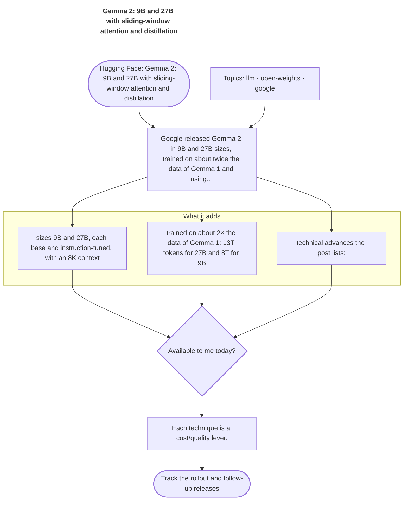

## What happened

**Google** released **Gemma 2**, four open-weight models, with Hugging Face integration (Transformers v4.42, Google Cloud, Inference Endpoints).

## The technical details

From the Hugging Face post:

- sizes **9B** and **27B**, each **base** and **instruction-tuned**, with an **8K** context
- trained on about **2× the data** of Gemma 1: **13T tokens** for 27B and 8T for 9B
- technical advances the post lists:
  - **sliding window attention** (interleaved with full attention)
  - **logit soft-capping**
  - **knowledge distillation** (smaller models learning from a larger teacher)
  - **model merging**

## How it fits together

The flowchart below maps this announcement's main points and what depends on them.

## Why it matters

Each technique is a cost/quality lever. Sliding windows cut attention cost on long inputs, and distillation transfers ability to smaller models. These are the same ideas from my LLM phase (quantisation, efficient attention) used in a production model.
