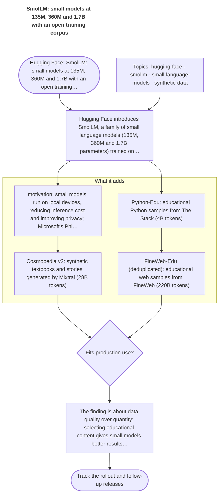

## What happened

On 16 July 2024 **Hugging Face** introduced **SmolLM**, a series of small language models at three sizes (135M, 360M and 1.7B parameters), built on a curated high-quality training corpus released as **SmolLM-Corpus**.

## The technical details

From the Hugging Face post:

- motivation: small models run on **local devices**, reducing inference cost and improving privacy; Microsoft's Phi, Alibaba's Qwen2 (under 2B) and Meta's MobileLLM show they can be strong, but their **data curation and training details are mostly not public**
- **Cosmopedia v2:** synthetic textbooks and stories generated by **Mixtral** (28B tokens)
- **Python-Edu:** educational Python samples from The Stack (4B tokens)
- **FineWeb-Edu (deduplicated):** educational web samples from FineWeb (220B tokens)

## How it fits together

The flowchart below maps this announcement's main points and what depends on them.

## Why it matters

The finding is about data quality over quantity: selecting educational content gives small models better results than raw scale. Releasing the corpus lets others test that claim.
