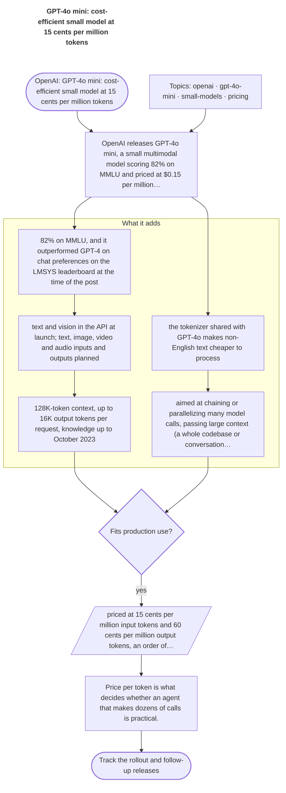

## What happened

On 18 July 2024 **OpenAI** announced **GPT-4o mini**, its most cost-efficient small model, aimed at widening the range of applications that are affordable to build.

## The technical details

From the OpenAI post:

- **82% on MMLU**, and it outperformed GPT-4 on chat preferences on the LMSYS leaderboard at the time of the post
- priced at **15 cents per million input tokens and 60 cents per million output tokens**, an order of magnitude cheaper than earlier frontier models and over 60% cheaper than GPT-3.5 Turbo
- **text and vision** in the API at launch; text, image, video and audio inputs and outputs planned
- **128K-token** context, up to **16K output tokens** per request, knowledge up to October 2023
- the tokenizer shared with GPT-4o makes non-English text cheaper to process
- aimed at chaining or parallelizing many model calls, passing large context (a whole codebase or conversation history), and fast real-time customer responses

## How it fits together

The flowchart below maps this announcement's main points and what depends on them.

## Why it matters

Price per token is what decides whether an agent that makes dozens of calls is practical. By pricing a capable model far below earlier ones, this release targets exactly those high-volume, multi-call applications.
