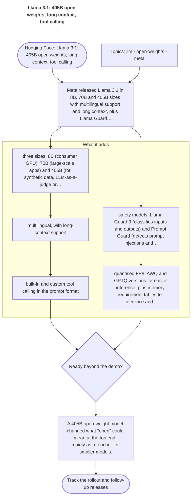

## What happened

**Meta** released **Llama 3.1**: eight open-weight models on the Hub (3 base, 5 fine-tuned), with Hugging Face integration across Transformers, TGI, HuggingChat (405B instruct) and several clouds.

## The technical details

From the Hugging Face post:

- three sizes: **8B** (consumer GPU), **70B** (large-scale apps) and **405B** (for **synthetic data**, **LLM-as-a-judge** or **distillation**)
- multilingual, with long-context support
- **built-in and custom tool calling** in the prompt format
- safety models: **Llama Guard 3** (classifies inputs and outputs) and **Prompt Guard** (detects prompt injections and jailbreaks)
- quantised **FP8, AWQ and GPTQ** versions for easier inference, plus memory-requirement tables for inference and training

## How it fits together

The flowchart below maps this announcement's main points and what depends on them.

## Why it matters

A 405B open-weight model changed what "open" could mean at the top end, mainly as a **teacher** for smaller models. Prompt Guard is an early example of the layered defences I described in my agent-safety post.
