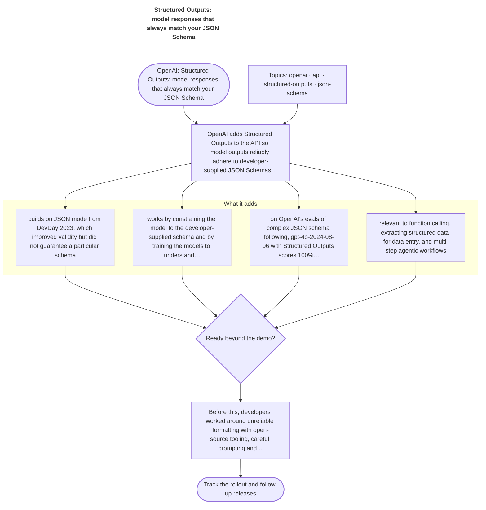

## What happened

On 6 August 2024 **OpenAI** introduced **Structured Outputs** in the API: a feature that constrains models to produce output that exactly matches a JSON Schema supplied by the developer.

## The technical details

From the OpenAI post:

- builds on **JSON mode** from DevDay 2023, which improved validity but did not guarantee a particular schema
- works by **constraining the model** to the developer-supplied schema and by **training the models** to understand complicated schemas better
- on OpenAI's evals of complex JSON schema following, **gpt-4o-2024-08-06 with Structured Outputs scores 100%**, compared with **under 40%** for gpt-4-0613
- relevant to function calling, extracting structured data for data entry, and multi-step agentic workflows

## How it fits together

The flowchart below maps this announcement's main points and what depends on them.

## Why it matters

Before this, developers worked around unreliable formatting with open-source tooling, careful prompting and repeated retries. Guaranteeing the schema turns an LLM call into something closer to a typed function, which is what agent workflows depend on.
