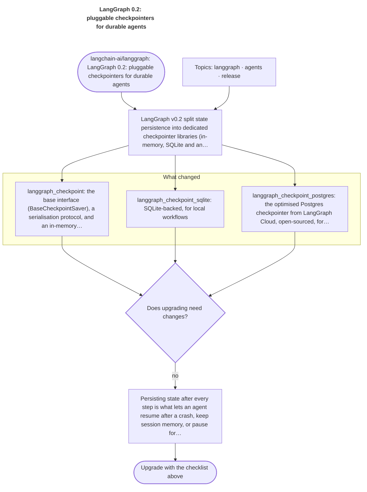

## What happened

**LangGraph v0.2** was released, focused on **checkpointers**, the component that saves a graph's state.

## The technical details

From the release notes, there are new dedicated libraries:

- **`langgraph_checkpoint`**: the base interface (`BaseCheckpointSaver`), a serialisation protocol, and an in-memory `MemorySaver` for experiments
- **`langgraph_checkpoint_sqlite`**: SQLite-backed, for local workflows
- **`langgraph_checkpoint_postgres`**: the optimised Postgres checkpointer from LangGraph Cloud, **open-sourced**, for production

Imports stay the same (`from langgraph.checkpoint.memory import MemorySaver`, etc.), and SQLite and Postgres are separate pip installs. The release also includes breaking changes, such as renamed `thread_ts` and `parent_ts`.

## How it fits together

The flowchart below maps this announcement's main points and what depends on them.

## Why it matters

Persisting state after every step is what lets an agent resume after a crash, keep **session memory**, or **pause for human approval** and continue later. The graph in my LangGraph study post had no checkpointer, so its state disappears after each run. A real app with a human-in-the-loop step needs one.
