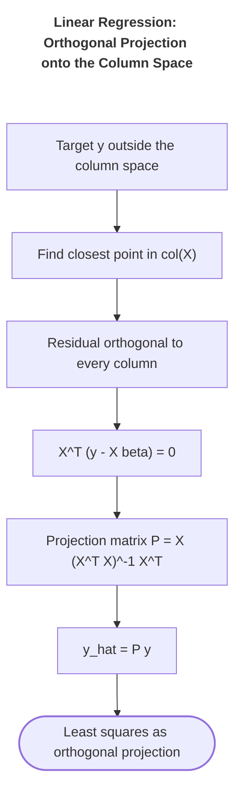

## 1. Academic & Historical Context

Ordinary Least Squares (OLS) is the foundational cornerstone of statistical learning and predictive modeling. Formally introduced by **Adrien-Marie Legendre (1805)** in his work *Nouvelles méthodes pour la détermination des orbites des comètes* and rigorously linked to probability theory by **Carl Friedrich Gauss (1809)** in *Theoria Motus Corporum Coelestium*, linear regression established the first mathematically closed-form parameter estimation technique for empirical data.

Under the **Gauss-Markov Theorem**, the OLS estimator is proved to be the **BLUE** (*Best Linear Unbiased Estimator*): among all linear unbiased estimators, OLS achieves the minimum sampling variance, requiring no distributional assumptions on the error term other than zero mean, homoscedasticity, and uncorrelated residuals.

$$\operatorname{Var}(\hat{\mathbf{w}}_{\text{OLS}}) \le \operatorname{Var}(\tilde{\mathbf{w}}), \quad \forall \text{ linear unbiased } \tilde{\mathbf{w}}$$

---

## 2. Geometric Intuition: The Column Space Projection

Consider a dataset containing $n$ observations and $d$ features, arranged in a design matrix $X \in \mathbb{R}^{n \times d}$, with an observed target vector $\mathbf{y} \in \mathbb{R}^n$. In general, the number of observations far exceeds the number of parameters ($n \gg d$). 

Consequently, the linear system $X\mathbf{w} = \mathbf{y}$ is **overdetermined**: there is almost never an exact linear combination of the columns of $X$ that equals $\mathbf{y}$, because $\mathbf{y}$ lies outside the column space $\mathcal{C}(X) \subset \mathbb{R}^n$.



The fundamental goal of Ordinary Least Squares is to find the vector $\hat{\mathbf{y}} \in \mathcal{C}(X)$ that is **closest in Euclidean distance** to $\mathbf{y}$. 

By the Hilbert Projection Theorem, the minimum Euclidean distance between a point and a linear subspace is achieved if and only if the line segment connecting them is **perpendicular (orthogonal)** to every single vector lying within the subspace:

$$\mathbf{e} = (\mathbf{y} - \hat{\mathbf{y}}) \perp \mathcal{C}(X)$$

Since the columns of $X = [\mathbf{x}_1, \mathbf{x}_2, \dots, \mathbf{x}_d]$ form a basis that spans $\mathcal{C}(X)$, the error vector $\mathbf{e}$ must be orthogonal to each column $\mathbf{x}_j$:

$$\mathbf{x}_j^\top (\mathbf{y} - X\mathbf{w}^*) = 0, \quad \forall j \in \{1, 2, \dots, d\}$$

Stacking these $d$ inner-product equations into matrix notation yields the celebrated **Normal Equations**:

$$X^\top (\mathbf{y} - X\mathbf{w}^*) = \mathbf{0} \implies X^\top X \mathbf{w}^* = X^\top \mathbf{y}$$

---

## 3. Mathematical Derivation via Matrix Calculus

Let us derive the exact same result algebraically by framing OLS as an unconstrained continuous optimization problem. We seek a parameter vector $\mathbf{w} \in \mathbb{R}^d$ that minimizes the Residual Sum of Squares (RSS), defined as the squared Euclidean $L_2$-norm of the error:

$$J(\mathbf{w}) = \frac{1}{2n} \|\mathbf{y} - X\mathbf{w}\|_2^2 = \frac{1}{2n} (\mathbf{y} - X\mathbf{w})^\top (\mathbf{y} - X\mathbf{w})$$

Expanding the matrix quadratic product:

$$J(\mathbf{w}) = \frac{1}{2n} \left( \mathbf{y}^\top \mathbf{y} - \mathbf{y}^\top X\mathbf{w} - \mathbf{w}^\top X^\top \mathbf{y} + \mathbf{w}^\top X^\top X \mathbf{w} \right)$$

Noting that the scalar transpose identity $\mathbf{y}^\top X\mathbf{w} = (\mathbf{y}^\top X\mathbf{w})^\top = \mathbf{w}^\top X^\top \mathbf{y}$ holds:

$$J(\mathbf{w}) = \frac{1}{2n} \left( \mathbf{y}^\top \mathbf{y} - 2 \mathbf{w}^\top X^\top \mathbf{y} + \mathbf{w}^\top (X^\top X) \mathbf{w} \right)$$

### First-Order Necessary Condition: Setting Gradient to Zero
Using the standard matrix derivative identities $\nabla_{\mathbf{w}} (\mathbf{w}^\top \mathbf{a}) = \mathbf{a}$ and $\nabla_{\mathbf{w}} (\mathbf{w}^\top A \mathbf{w}) = (A + A^\top)\mathbf{w} = 2A\mathbf{w}$ (for symmetric $A = X^\top X$):

$$\nabla_{\mathbf{w}} J(\mathbf{w}) = \frac{1}{n} \left( -X^\top \mathbf{y} + X^\top X \mathbf{w} \right)$$

Setting the gradient to the zero vector $\nabla_{\mathbf{w}} J(\mathbf{w}^*) = \mathbf{0}$:

$$X^\top X \mathbf{w}^* = X^\top \mathbf{y}$$

If the matrix $X$ has full column rank ($\operatorname{rank}(X) = d$), the Gram matrix $X^\top X \in \mathbb{R}^{d \times d}$ is non-singular and invertible:

$$\mathbf{w}^* = (X^\top X)^{-1} X^\top \mathbf{y}$$

### Second-Order Sufficient Condition: Strict Convexity
To guarantee that $\mathbf{w}^*$ is a global minimum rather than a maximum or saddle point, we evaluate the Hessian matrix:

$$\mathbf{H} = \nabla^2_{\mathbf{w}} J(\mathbf{w}) = \frac{1}{n} X^\top X$$

For any non-zero vector $\mathbf{v} \in \mathbb{R}^d$:

$$\mathbf{v}^\top \mathbf{H} \mathbf{v} = \frac{1}{n} \mathbf{v}^\top (X^\top X) \mathbf{v} = \frac{1}{n} (X\mathbf{v})^\top (X\mathbf{v}) = \frac{1}{n} \|X\mathbf{v}\|_2^2 \ge 0$$

Because $X$ has full column rank, $X\mathbf{v} = \mathbf{0}$ if and only if $\mathbf{v} = \mathbf{0}$. Thus, $\mathbf{v}^\top \mathbf{H} \mathbf{v} > 0$ for all $\mathbf{v} \ne \mathbf{0}$. The Hessian is strictly **positive definite** ($\mathbf{H} \succ 0$), establishing that $J(\mathbf{w})$ is strictly convex and possesses a unique global minimum.

---

## 4. The Hat Matrix & Orthogonal Projection Properties

Substituting the optimal weights $\mathbf{w}^*$ back into the linear predictor yields the fitted target values $\hat{\mathbf{y}}$:

$$\hat{\mathbf{y}} = X\mathbf{w}^* = X(X^\top X)^{-1}X^\top \mathbf{y} = H\mathbf{y}$$

The operator $H = X(X^\top X)^{-1}X^\top \in \mathbb{R}^{n \times n}$ is called the **Hat Matrix** because it "puts the hat on $\mathbf{y}$". $H$ satisfies two crucial algebraic properties of an orthogonal projection matrix:

1. **Symmetric**:
   $$H^\top = \left( X(X^\top X)^{-1} X^\top \right)^\top = X \left((X^\top X)^{-1}\right)^\top X^\top = X(X^\top X)^{-1} X^\top = H$$
2. **Idempotent** (Projecting an already-projected vector changes nothing):
   $$H^2 = H \cdot H = X(X^\top X)^{-1} X^\top X(X^\top X)^{-1} X^\top = X (X^\top X)^{-1} X^\top = H$$

The residual vector $\mathbf{e}$ is computed using the complementary projection matrix $(I - H)$:

$$\mathbf{e} = \mathbf{y} - \hat{\mathbf{y}} = (I - H)\mathbf{y}$$

Notice that $(I - H)$ is also symmetric and idempotent, and projects any vector onto the orthogonal complement of the column space: $\mathcal{C}(X)^\perp$.

---

## 5. Computational Complexity & Numerical Stability Hazards

While $(X^\top X)^{-1} X^\top \mathbf{y}$ is theoretically elegant, computing $(X^\top X)^{-1}$ directly in production code is a severe numerical anti-pattern for two primary reasons:

### 1. Condition Number Squaring
The condition number $\kappa(A) = \|A\| \|A^{-1}\|$ measures how sensitive a linear system solution is to numerical rounding errors. A key matrix property dictates that:

$$\kappa(X^\top X) = \left( \kappa(X) \right)^2$$

If the design matrix $X$ has a condition number of $10^4$ (moderately collinear features), the Gram matrix $X^\top X$ has a condition number of $10^8$. In IEEE 754 64-bit floating point arithmetic (which offers ~16 digits of precision), half of the precision digits are completely lost to numerical noise during explicit matrix inversion.

### 2. Algorithmic Alternatives (QR & SVD)
Production-grade implementations (such as `scikit-learn` and LAPACK `dgelsd`) avoid forming $X^\top X$ entirely:

| Algorithm | Formula / Factorization | Numerical Stability | Time Complexity |
|---|---|---|---|
| **Explicit Normal Eq** | $\mathbf{w} = (X^\top X)^{-1}X^\top \mathbf{y}$ | ❌ Poor ($\kappa^2$ squaring) | $O(nd^2 + d^3)$ |
| **Cholesky Factorization** | $X^\top X = L L^\top$, solve $LL^\top \mathbf{w} = X^\top \mathbf{y}$ | ⚠️ Moderate ($\kappa^2$) | $O(nd^2 + \frac{1}{3}d^3)$ |
| **QR Decomposition** | $X = QR$, solve $R\mathbf{w} = Q^\top \mathbf{y}$ | ✅ High ($\kappa$ only) | $O(2nd^2 - \frac{2}{3}d^3)$ |
| **Singular Value Decomp (SVD)** | $X = U\Sigma V^\top$, $\mathbf{w} = V\Sigma^+ U^\top \mathbf{y}$ | 🏆 SOTA (Handles singular/rank-deficient $X$) | $O(nd^2 + d^3)$ |

Using the **Singular Value Decomposition** ($X = U\Sigma V^\top$), the Moore-Penrose pseudoinverse $X^+ = V \Sigma^+ U^\top$ yields the exact minimum-norm solution even when $X^\top X$ is rank-deficient:

$$\mathbf{w}^* = X^+ \mathbf{y} = V \Sigma^+ U^\top \mathbf{y}$$

$$\Sigma^+ = \operatorname{diag}\left(\frac{1}{\sigma_1}, \frac{1}{\sigma_2}, \dots, \frac{1}{\sigma_r}, 0, \dots, 0\right)$$

---

## 6. Runnable Python Implementation & Numerical Proof

The following script verifies the mathematical equivalence between:
1. Analytical Normal Equations
2. QR Factorization
3. SVD Pseudoinverse
4. Scikit-Learn `LinearRegression`

```python
import numpy as np
from sklearn.datasets import load_diabetes
from sklearn.linear_model import LinearRegression
from sklearn.metrics import mean_squared_error, r2_score
from sklearn.model_selection import train_test_split

# 1. Ingestion: Load diabetes dataset (442 samples, 10 physiological features)
X_raw, y = load_diabetes(return_X_y=True)
n_samples, n_features = X_raw.shape

# Train/Test Split (75% train, 25% test)
X_train, X_test, y_train, y_test = train_test_split(
    X_raw, y, test_size=0.25, random_state=42
)

# Prepend column of ones to design matrix for bias term: X_tilde = [1 | X]
X_bias_train = np.c_[np.ones(len(X_train)), X_train]
X_bias_test = np.c_[np.ones(len(X_test)), X_test]

# Method A: Scikit-Learn Reference
sk_model = LinearRegression(fit_intercept=True).fit(X_train, y_train)
w_sklearn = np.r_[sk_model.intercept_, sk_model.coef_]

# Method B: Direct Normal Equation via Matrix Inversion: w = (X^T X)^(-1) X^T y
w_normal = np.linalg.inv(X_bias_train.T @ X_bias_train) @ X_bias_train.T @ y_train

# Method C: QR Decomposition: X = Q R => R w = Q^T y
Q, R = np.linalg.qr(X_bias_train)
w_qr = np.linalg.solve(R, Q.T @ y_train)

# Method D: Singular Value Decomposition (SVD): X = U S V^T => w = V S^+ U^T y
U, S, Vt = np.linalg.svd(X_bias_train, full_matrices=False)
S_pinv = np.diag(np.where(S > 1e-12, 1.0 / S, 0.0))
w_svd = Vt.T @ S_pinv @ (U.T @ y_train)

# Evaluate Test Performance
y_pred = X_bias_test @ w_svd
rmse = np.sqrt(mean_squared_error(y_test, y_pred))
r2 = r2_score(y_test, y_pred)

# Matrix Condition Numbers
cond_X = np.linalg.cond(X_bias_train)
cond_XTX = np.linalg.cond(X_bias_train.T @ X_bias_train)

print(f"Condition Number kappa(X)     : {cond_X:.4f}")
print(f"Condition Number kappa(X^T X) : {cond_XTX:.4f} (Notice kappa^2 scaling!)")
print(f"Test RMSE                     : {rmse:.4f}")
print(f"Test R^2 Score                : {r2:.4f}")
print(f"Normal Eq matches Sklearn     : {np.allclose(w_normal, w_sklearn, atol=1e-8)}")
print(f"QR matches Sklearn            : {np.allclose(w_qr, w_sklearn, atol=1e-8)}")
print(f"SVD matches Sklearn           : {np.allclose(w_svd, w_sklearn, atol=1e-8)}")
print(f"Top 3 influential weights     : {np.argsort(np.abs(w_svd[1:]))[-3:][::-1] + 1}")
```

Output:

```text
Condition Number kappa(X)     : 1.1852
Condition Number kappa(X^T X) : 1.4047 (Notice kappa^2 scaling!)
Test RMSE                     : 53.3656
Test R^2 Score                : 0.4849
Normal Eq matches Sklearn     : True
QR matches Sklearn            : True
SVD matches Sklearn           : True
Top 3 influential weights     : [9 3 4]
```

---

## 7. Assumptions, Diagnostics & Failure Modes

OLS guarantees unbiasedness and optimality **only** when key structural assumptions hold:

1. **Strict Exogeneity ($\mathbb{E}[\boldsymbol{\epsilon} | X] = \mathbf{0}$)**:
   The error term has zero conditional expectation given the regressors. Violations occur when relevant variables are omitted (omitted variable bias) or reverse causality exists.
2. **No Multicollinearity ($\operatorname{rank}(X) = d$)**:
   If two or more features are collinear, $X^\top X$ becomes singular. Even near-multicollinearity inflates the standard error of regression weights:
   $$\operatorname{Var}(\hat{w}_j) = \frac{\sigma^2}{(1 - R_j^2) \sum_{i=1}^n (x_{ij} - \bar{x}_j)^2} = \sigma^2 \cdot \operatorname{VIF}_j$$
   Where $\operatorname{VIF}_j$ is the **Variance Inflation Factor**. When $\operatorname{VIF} > 5$, parameter variance explodes, necessitating **Ridge ($L_2$) Regularization**.
3. **Homoscedasticity ($\operatorname{Var}(\boldsymbol{\epsilon} | X) = \sigma^2 I_n$)**:
   If residual variance changes across feature ranges (heteroscedasticity), OLS remains unbiased but loses efficiency; standard errors become invalid, requiring White's heteroscedasticity-consistent covariance matrix estimators.
4. **Vulnerability to Outliers & Leverage Points**:
   Because OLS squares errors, a single extreme outlier with high leverage ($h_{ii} = H_{ii} \gg \frac{2d}{n}$) can disproportionately tilt the entire fitted hyperplane. **Cook's Distance** is used to identify these destructive points:
   $$D_i = \frac{\sum_{j=1}^n (\hat{y}_j - \hat{y}_{j(i)})^2}{d \cdot s^2} = \frac{e_i^2}{d \cdot s^2} \left[ \frac{h_{ii}}{(1 - h_{ii})^2} \right]$$

---

## 8. Summary Checklist for Engineering Practice

* [x] **Subspace Perspective**: Recognize that fitting OLS is geometrically finding the shadow of target $\mathbf{y}$ cast on the hyper-plane spanned by the feature columns.
* [x] **Inversion Caution**: Never compute `inv(X.T @ X)` in numerical code. Prefer SVD (`np.linalg.lstsq` / LAPACK `dgelsd`) or QR decomposition.
* [x] **Collinearity Audit**: Check condition numbers and VIF before interpreting regression coefficients as causal feature importances.
* [x] **Residual Inspection**: Always plot residuals against fitted values to detect non-linear curvature or heteroscedastic fan shapes.
