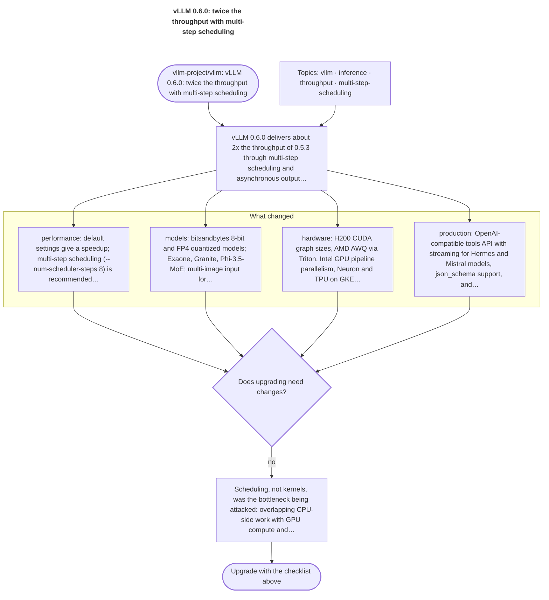

## What happened

On 4 September 2024 the **vLLM** project released **v0.6.0**, a performance release announced as delivering **2x more throughput** than v0.5.3.

## The technical details

From the release notes:

- **performance:** default settings give a speedup; **multi-step scheduling** (`--num-scheduler-steps 8`) is recommended on top, though it still has limitations; an **asynchronous output processor** overlaps output processing with GPU work for **12%** more throughput; FlashInfer backend for FP8 KV cache; rejection sampling in speculative decoding
- **models:** bitsandbytes 8-bit and FP4 quantized models; Exaone, Granite, Phi-3.5-MoE; multi-image input for LLaVA-Next and Phi-3-vision
- **hardware:** H200 CUDA graph sizes, AMD AWQ via Triton, Intel GPU pipeline parallelism, Neuron and TPU on GKE improvements
- **production:** OpenAI-compatible **tools API with streaming** for Hermes and Mistral models, `json_schema` support, and **chunked prefill with prefix caching together**

## How it fits together

The flowchart below maps this announcement's main points and what depends on them.

## Why it matters

Scheduling, not kernels, was the bottleneck being attacked: overlapping CPU-side work with GPU compute and batching several decode steps per scheduling pass. It builds on the prefix caching covered in this blog's vLLM 0.4 post.
