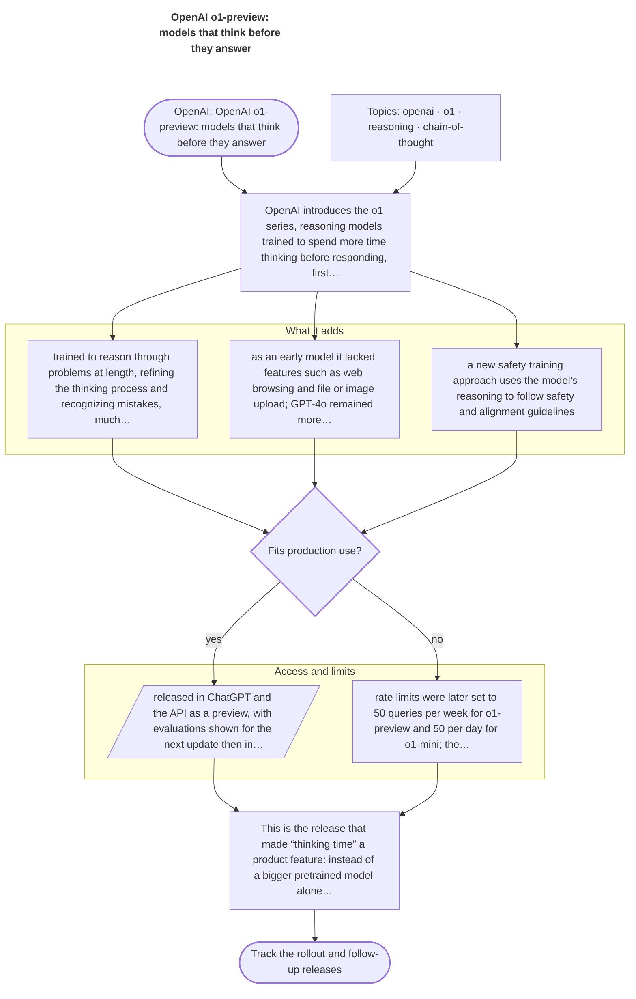

## What happened

On 12 September 2024 **OpenAI** released **o1-preview**, the first of a new series of models designed to spend more time thinking before they respond, to solve harder problems in science, coding and math.

## The technical details

From the OpenAI post:

- trained to **reason through problems at length**, refining the thinking process and recognizing mistakes, much like a person would
- released in **ChatGPT and the API** as a preview, with evaluations shown for the next update then in development
- as an early model it lacked features such as **web browsing** and **file or image upload**; GPT-4o remained more capable for many common cases
- a **new safety training approach** uses the model's reasoning to follow safety and alignment guidelines
- rate limits were later set to 50 queries per week for o1-preview and 50 per day for o1-mini; the page now notes both have been retired from the API

## How it fits together

The flowchart below maps this announcement's main points and what depends on them.

## Why it matters

This is the release that made “thinking time” a product feature: instead of a bigger pretrained model alone, quality came from letting the model reason longer at inference. The post is explicit that for everyday tasks GPT-4o was still the better choice, positioning o1 for hard reasoning problems.
