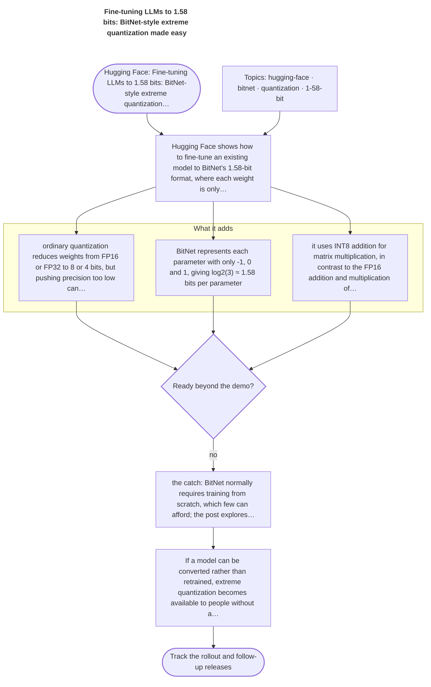

## What happened

On 18 September 2024 **Hugging Face** published a guide to extreme quantization: fine-tuning existing models to the **1.58-bit** format introduced by Microsoft Research's **BitNet**, rather than pre-training a new model.

## The technical details

From the Hugging Face post:

- ordinary quantization reduces weights from FP16 or FP32 to 8 or 4 bits, but pushing precision too low can degrade accuracy
- **BitNet** represents each parameter with only **-1, 0 and 1**, giving **log2(3) ≈ 1.58 bits per parameter**
- it uses **INT8 addition** for matrix multiplication, in contrast to the FP16 addition and multiplication of LLaMA-style models, so theoretical energy use falls
- the catch: BitNet normally **requires training from scratch**, which few can afford; the post explores **tricks for fine-tuning an existing model** to 1.58 bits

## How it fits together

The flowchart below maps this announcement's main points and what depends on them.

## Why it matters

If a model can be converted rather than retrained, extreme quantization becomes available to people without a pre-training budget. The post is candid that the format is a different computation paradigm, not just a smaller number format.
