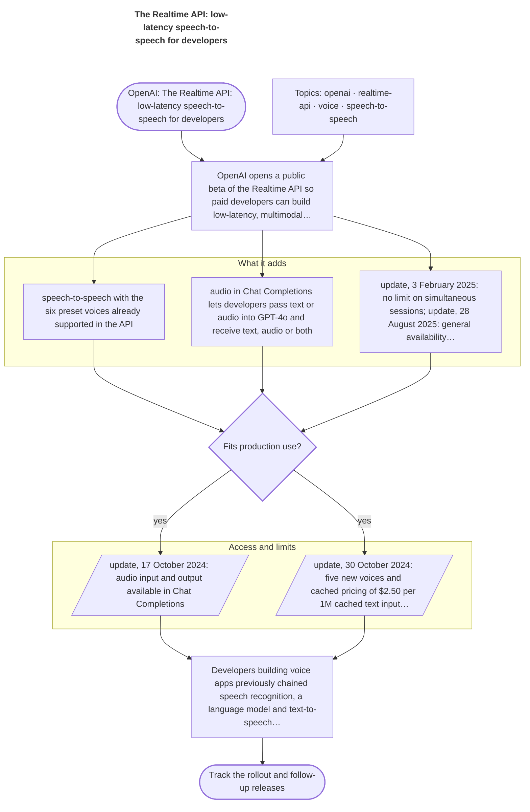

## What happened

On 1 October 2024 **OpenAI** introduced a public beta of the **Realtime API**, letting all paid developers add low-latency voice conversations to their apps. The same day it announced audio input and output in the **Chat Completions API** for use cases that do not need the lowest latency.

## The technical details

From the OpenAI post:

- **speech-to-speech** with the six preset voices already supported in the API
- audio in Chat Completions lets developers pass text or audio into **GPT-4o** and receive text, audio or both
- update, 17 October 2024: audio input and output available in Chat Completions
- update, 30 October 2024: five new voices and cached pricing of **$2.50 per 1M cached text input tokens** and **$20 per 1M cached audio input tokens**
- update, 3 February 2025: no limit on simultaneous sessions; update, **28 August 2025**: general availability announced

## How it fits together

The flowchart below maps this announcement's main points and what depends on them.

## Why it matters

Developers building voice apps previously chained speech recognition, a language model and text-to-speech themselves. A single streaming API removes that glue and the latency it adds, which is what language-learning, education and customer-support voice apps need.
