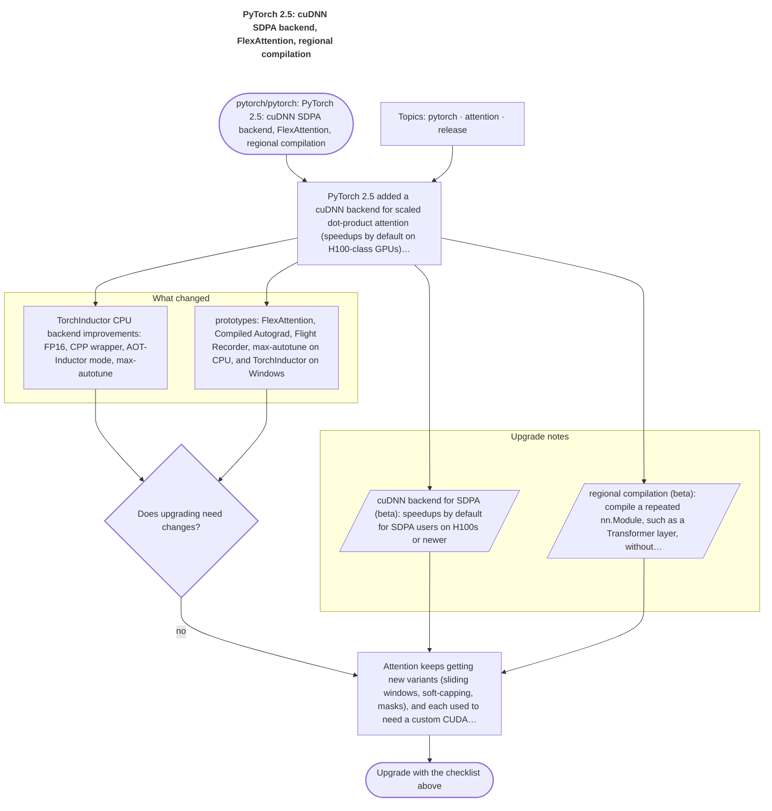

## What happened

**PyTorch 2.5** was released, with 4,095 commits from 504 contributors since 2.4.

## The technical details

From the release notes:

- **cuDNN backend for SDPA** (beta): speedups by default for SDPA users on **H100s or newer**
- **regional compilation** (beta): compile a **repeated `nn.Module`**, such as a Transformer layer, **without recompilations**, to cut `torch.compile` cold-start time
- **TorchInductor CPU backend** improvements: FP16, CPP wrapper, AOT-Inductor mode, max-autotune
- prototypes: **FlexAttention**, Compiled Autograd, Flight Recorder, max-autotune on CPU, and **TorchInductor on Windows**

## How it fits together

The flowchart below maps this announcement's main points and what depends on them.

## Why it matters

Attention keeps getting new variants (sliding windows, soft-capping, masks), and each used to need a custom CUDA kernel. **FlexAttention** aims to let researchers express a variant in PyTorch and still get a fused, fast kernel. Regional compilation addresses a practical annoyance: `torch.compile` taking a long time to start on big models.
