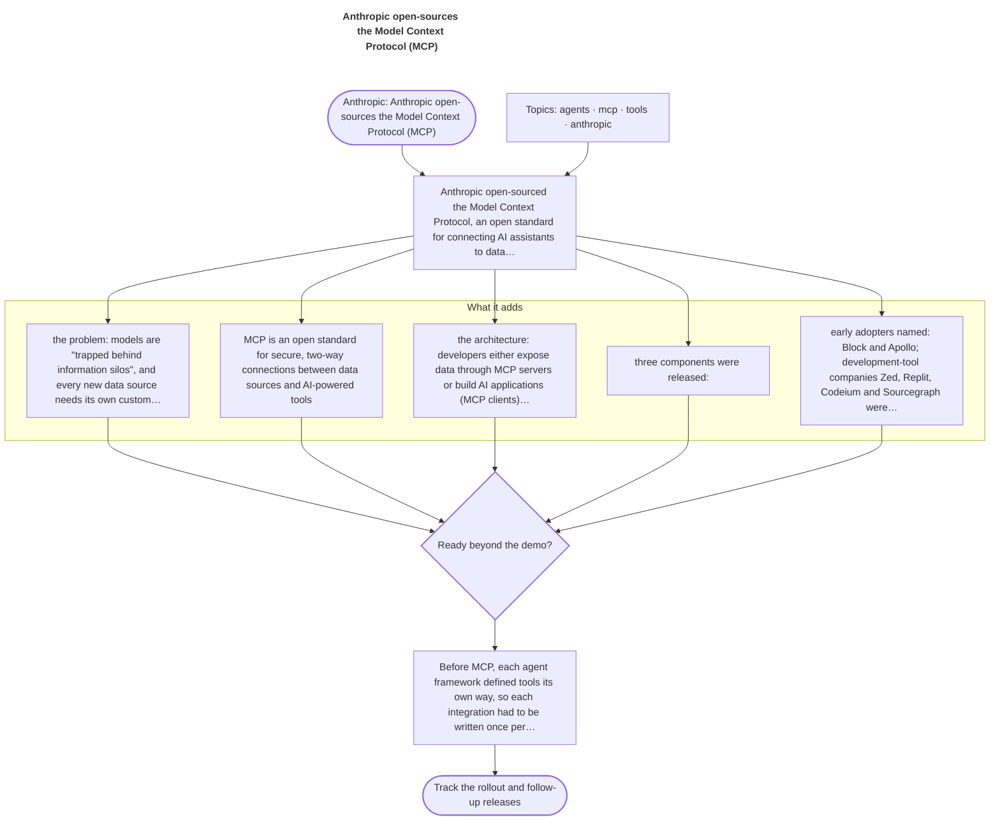

## What happened

**Anthropic** open-sourced the **Model Context Protocol (MCP)**, which it describes as a new standard for connecting AI assistants to the systems where data lives: content repositories, business tools and development environments.

## The technical details

From the announcement:

- the problem: models are "trapped behind information silos", and every new data source needs its **own custom implementation**
- MCP is an **open standard** for **secure, two-way connections** between data sources and AI-powered tools
- the architecture: developers either **expose data through MCP servers** or build **AI applications (MCP clients)** that connect to them
- three components were released:
  1. the MCP **specification and SDKs**
  2. **local MCP server support** in the Claude Desktop apps
  3. an **open-source repository of MCP servers**, with pre-built servers for Google Drive, Slack, GitHub, Git, Postgres and Puppeteer
- early adopters named: Block and Apollo; development-tool companies Zed, Replit, Codeium and Sourcegraph were working with MCP

## How it fits together

The flowchart below maps this announcement's main points and what depends on them.

## Why it matters

Before MCP, each agent framework defined tools its own way, so each integration had to be written once per framework. In my September 2026 study post I built a small MCP server and client with the official Python SDK. By 2026, an MCP-based benchmark (MCP Atlas) appears in Google's Gemini 3.5 launch numbers, which shows how quickly it became shared infrastructure.
