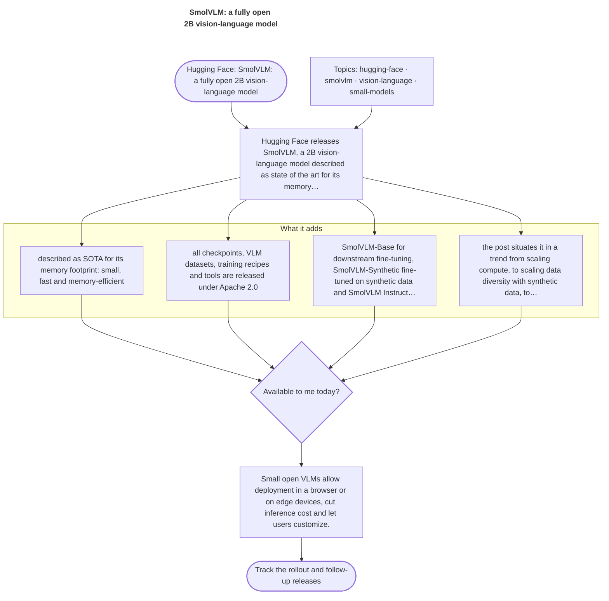

## What happened

On 26 November 2024 **Hugging Face** introduced **SmolVLM**, a family of 2B vision-language models that can be used commercially and deployed on smaller local setups, with completely open training pipelines.

## The technical details

From the Hugging Face post:

- described as **SOTA for its memory footprint**: small, fast and memory-efficient
- all **checkpoints, VLM datasets, training recipes and tools** are released under **Apache 2.0**
- **SmolVLM-Base** for downstream fine-tuning, **SmolVLM-Synthetic** fine-tuned on synthetic data and **SmolVLM Instruct** for out-of-the-box interactive use
- the post situates it in a trend from scaling compute, to scaling data diversity with synthetic data, to **scaling down** for efficient local deployment

## How it fits together

The flowchart below maps this announcement's main points and what depends on them.

## Why it matters

Small open VLMs allow deployment in a browser or on edge devices, cut inference cost and let users customize. The Apache 2.0 license on everything, including data and recipes, is what distinguishes it from models that release weights alone.
