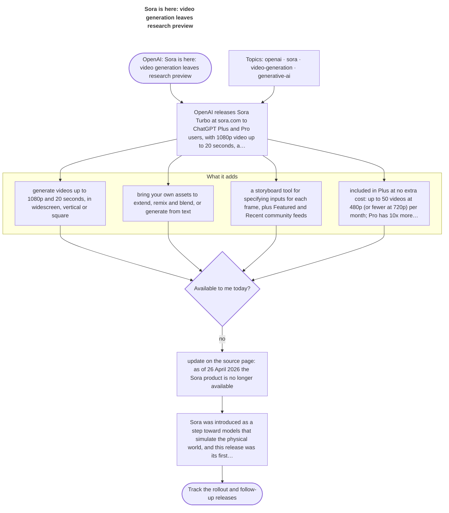

## What happened

On 9 December 2024 **OpenAI** moved its video generation model out of research preview, releasing **Sora Turbo**, described as significantly faster than the model previewed in February, as a standalone product at sora.com for ChatGPT Plus and Pro users.

## The technical details

From the OpenAI post:

- generate videos up to **1080p and 20 seconds**, in widescreen, vertical or square
- bring your own assets to **extend, remix and blend**, or generate from text
- a **storyboard** tool for specifying inputs for each frame, plus **Featured and Recent** community feeds
- included in Plus at no extra cost: up to **50 videos at 480p** (or fewer at 720p) per month; **Pro** has 10x more usage, higher resolutions and longer durations
- **update on the source page:** as of 26 April 2026 the Sora product is no longer available

## How it fits together

The flowchart below maps this announcement's main points and what depends on them.

## Why it matters

Sora was introduced as a step toward models that simulate the physical world, and this release was its first consumer form. The banner added in 2026 is a reminder that even prominent launches can be retired, so the date matters when citing a product.
