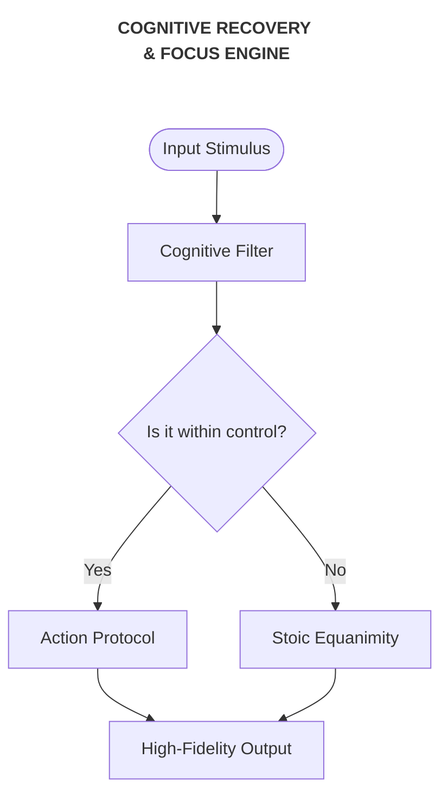

> "Programs must be written for people to read, and only incidentally for machines to execute."
> 
> — **Harold Abelson**

---

### 1. The Core Tension & Reality

In the high-velocity landscape of modern software engineering and artificial intelligence research, the greatest bottleneck is rarely compute, tooling, or information accessibility. The fundamental bottleneck is human cognitive fidelity, attention regulation, and psychological equanimity.

True technical mastery manifests as ruthless simplicity, not convoluted intellectual acrobatics. The finest architecture is invisible.

Every day, developers and researchers are bombarded by context switches, hyper-connected notification streams, and the constant fear of obsolescence. Without a deliberate cognitive framework, attention fragments, stress accumulates, and high-order creative synthesis becomes structurally impossible.

---

### 2. First-Principles Deconstruction

When we analyze performance from first principles, we discover that technical mastery is a compounding function of uninterrupted focus and emotional stability:

$$\text{Clarity} = \frac{\text{Expressed Intent}}{\text{Lines of Code} + \text{Implicit State}}$$

Consider how energy and working memory operate in software development:
1. **Working Memory Constraints**: Human prefrontal cortex capacity is finite. When working through complex mathematical proofs or multi-threaded distributed logic, even a 10-second distraction flushes the mental cache, requiring up to 20 minutes of re-immersion.
2. **The Friction Gradient**: Whatever behavior is frictionless will dominate your daily output. If distracting feeds are one click away and documentation requires searching, the brain naturally gravitates toward path-of-least-resistance dopamine loops.
3. **Internal Scorecard**: True engineering craftsmanship cannot be measured by external corporate validation or social metrics. It is grounded in the intrinsic standard of the work itself.

---

### 3. The Protocol: Systematic Implementation

To translate theoretical mindset into concrete daily execution, apply these non-negotiable operational rules:

- **The Protected Focus Window**: Block the first 3 hours of the working day for deep technical synthesis. No email, no chat, no meetings. Treat this block as sacred and inviolable.
- **Micro-Friction Inversion**: Introduce intentional physical barriers between yourself and attention traps. Keep phones in another room; install site blockers; use dedicated clean terminal workspaces.
- **Ruthless Scope Pruning**: When faced with overwhelming architectural complexity, isolate the single critical path. Defer all secondary features until the foundational primitive is mathematically sound.
- **The Shutdown Ritual**: When the workday terminates, conduct a 5-minute debrief. Write down outstanding open questions, clear your workspace, and mentally disconnect to allow subconscious incubation.

---

### 4. Mathematical Analogy: Compounding & Entropy

In physical thermodynamics and information theory, closed systems naturally tend toward maximum disorder unless external energy is continuously applied:

$$\Delta S_{\text{mind}} \ge 0 \quad \implies \quad \text{Order Requires Active Work}$$

Just as an unmaintained codebase accumulates technical debt, an unexamined mind accumulates psychological entropy. Disciplined habits, daily journaling, and rigorous physical recovery are the external energy inputs required to keep your intellectual engine operating in a state of low-entropy coherence.

---

### 5. Daily Stoic Reflection & Actionable Takeaway

Remember that you control your responses, not the pull request comments or the server downtime. Guard your tranquility as your most valuable asset.
