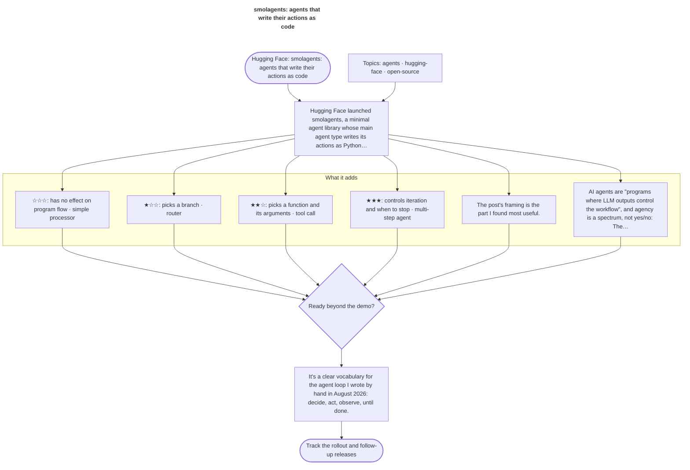

## What happened

Hugging Face launched **smolagents**, a very small library for building agents. The headline agent is a **`CodeAgent`**, which writes its actions as **Python code**.

## The technical details

The post's framing is the part I found most useful. **AI agents are "programs where LLM outputs control the workflow"**, and agency is a **spectrum**, not yes/no:

| level | LLM output… | name |
|---|---|---|
| ☆☆☆ | has no effect on program flow | simple processor |
| ★☆☆ | picks a branch | router |
| ★★☆ | picks a function and its arguments | tool call |
| ★★★ | controls iteration and when to stop | multi-step agent |

The post also discusses how well open models do on agentic workflows.

## How it fits together

The flowchart below maps this announcement's main points and what depends on them.

## Why it matters

It's a clear vocabulary for the agent loop I wrote by hand in August 2026: decide, act, observe, until done. Writing actions as code, rather than as one JSON tool call at a time, lets a single step combine several tools with loops and variables.
