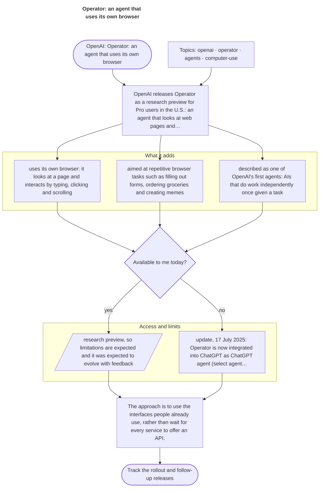

## What happened

On 23 January 2025 **OpenAI** released **Operator**, an agent that can go to the web and perform tasks for you. It was launched as a research preview to ChatGPT Pro users in the U.S., so that OpenAI could learn from real use before widening access.

## The technical details

From the OpenAI post:

- uses its **own browser**: it looks at a page and interacts by **typing, clicking and scrolling**
- aimed at repetitive browser tasks such as **filling out forms, ordering groceries and creating memes**
- described as one of OpenAI's first **agents**: AIs that do work independently once given a task
- **research preview**, so limitations are expected and it was expected to evolve with feedback
- **update, 17 July 2025:** Operator is now integrated into ChatGPT as ChatGPT agent (select agent mode), and operator.chatgpt.com was to sunset in the following weeks

## How it fits together

The flowchart below maps this announcement's main points and what depends on them.

## Why it matters

The approach is to use the interfaces people already use, rather than wait for every service to offer an API. That is also why the rollout started small, to Pro users in one country: an agent that acts on websites has to be tested against the real, messy web before it is widely available.
