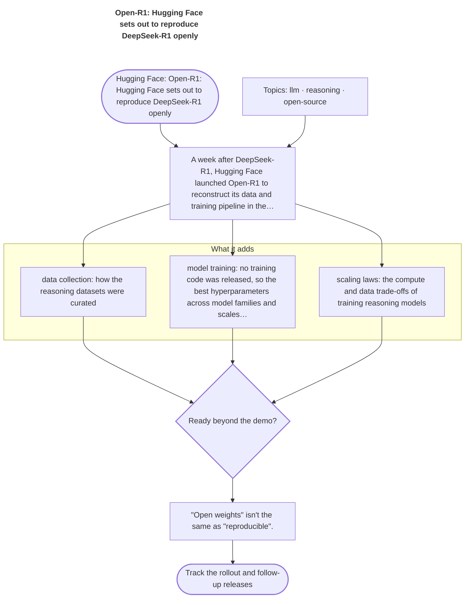

## What happened

Hugging Face launched **Open-R1**, a project to systematically **reconstruct DeepSeek-R1's data and training pipeline**, validate its claims, and push open reasoning models further.

## The technical details

The post explains why it was needed. DeepSeek-R1 (summarised here on 23 Jan 2025) came with weights and a detailed technical report whose most notable step was **pure reinforcement learning** to teach a base model to reason, but it left open:

- **data collection**: how the reasoning datasets were curated
- **model training**: no training code was released, so the best hyperparameters across model families and scales were unknown
- **scaling laws**: the compute and data trade-offs of training reasoning models

## How it fits together

The flowchart below maps this announcement's main points and what depends on them.

## Why it matters

"Open weights" isn't the same as "reproducible". Open-R1 follows the same logic as LLM360 and OLMo (summarised Dec 2023 and Feb 2024): publish the recipe, not just the result.
