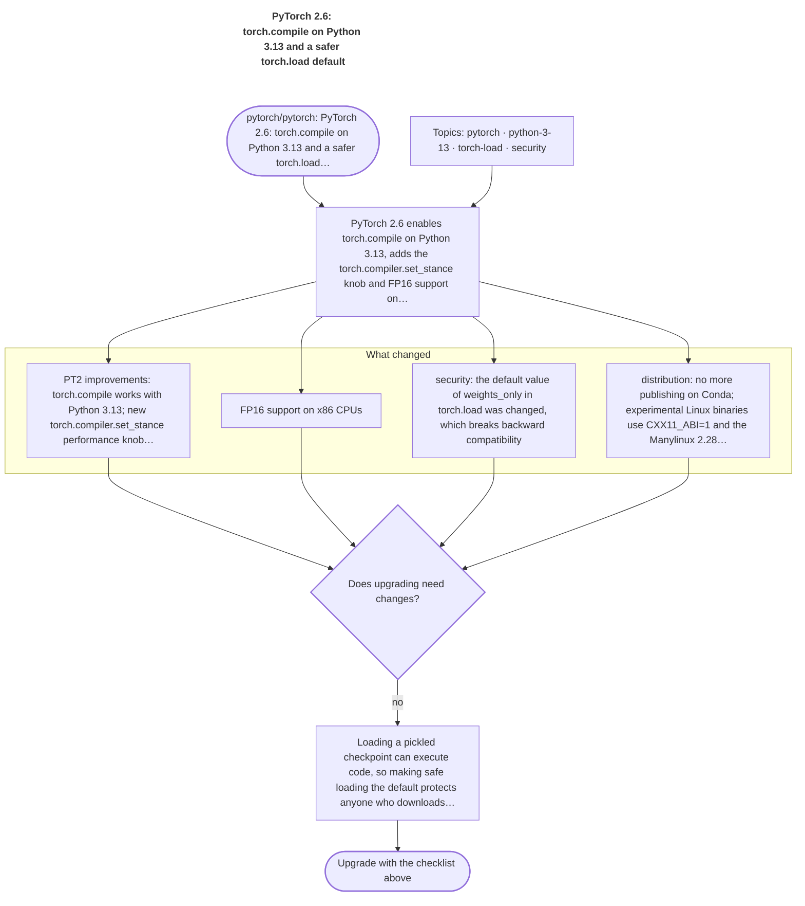

## What happened

On 29 January 2025 the **PyTorch** team released **2.6**, composed of 3,892 commits from 520 contributors since 2.5.

## The technical details

From the release notes:

- **PT2 improvements:** `torch.compile` works with **Python 3.13**; new `torch.compiler.set_stance` performance knob; several **AOTInductor** enhancements
- **FP16 support on x86 CPUs**
- **security:** the default value of `weights_only` in `torch.load` was changed, which breaks backward compatibility
- **distribution:** no more publishing on **Conda**; experimental Linux binaries use CXX11_ABI=1 and the Manylinux 2.28 build platform, with all Linux builds planned to follow in 2.7

## How it fits together

The flowchart below maps this announcement's main points and what depends on them.

## Why it matters

Loading a pickled checkpoint can execute code, so making safe loading the default protects anyone who downloads weights. The cost is that old code which loaded arbitrary objects must now opt in explicitly.
