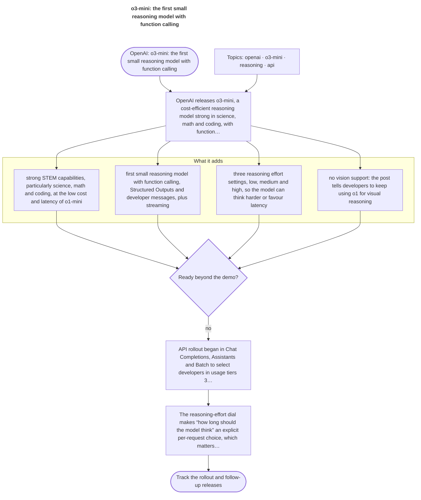

## What happened

On 31 January 2025 **OpenAI** released **o3-mini**, the newest and most cost-efficient model in its reasoning series, in both ChatGPT and the API. It had been previewed in December 2024.

## The technical details

From the OpenAI post:

- strong **STEM** capabilities, particularly science, math and coding, at the low cost and latency of o1-mini
- first small reasoning model with **function calling**, **Structured Outputs** and **developer messages**, plus streaming
- three **reasoning effort** settings, low, medium and high, so the model can think harder or favour latency
- **no vision support**: the post tells developers to keep using o1 for visual reasoning
- API rollout began in Chat Completions, Assistants and Batch to select developers in usage tiers 3 to 5; the page now notes o3-mini is deprecated in the API

## How it fits together

The flowchart below maps this announcement's main points and what depends on them.

## Why it matters

The reasoning-effort dial makes “how long should the model think” an explicit per-request choice, which matters for cost. Shipping the usual developer features with a small reasoning model made it usable in production tool-calling workflows from the first day.
