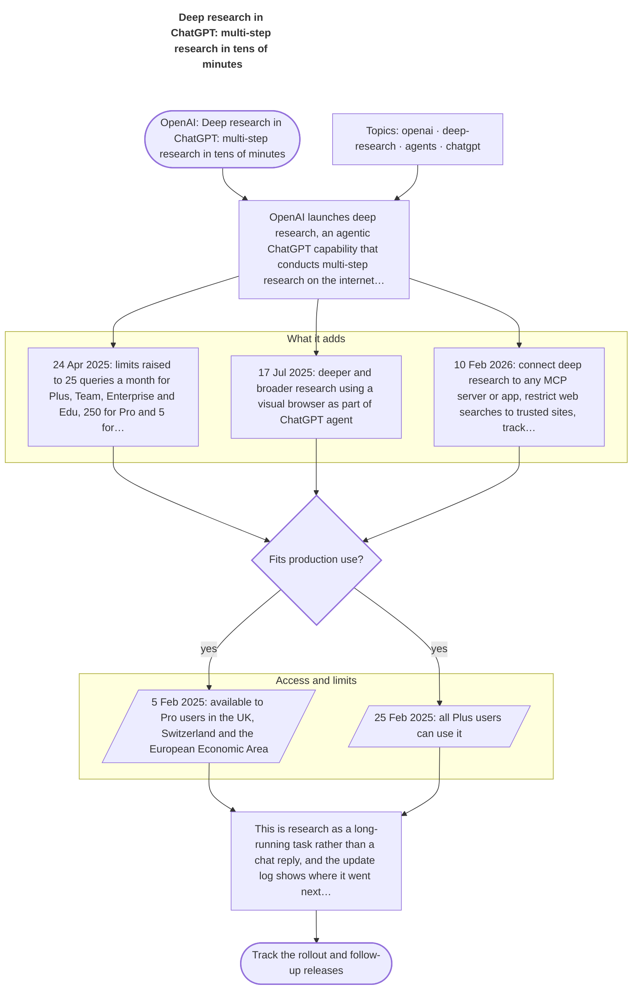

## What happened

On 2 February 2025 **OpenAI** launched **deep research** in ChatGPT, a new agentic capability for complex tasks that conducts multi-step research on the internet, finishing in tens of minutes work that would take a person many hours.

## The technical details

From the OpenAI post:

- **5 Feb 2025:** available to Pro users in the UK, Switzerland and the European Economic Area
- **25 Feb 2025:** all Plus users can use it
- **24 Apr 2025:** limits raised to 25 queries a month for Plus, Team, Enterprise and Edu, 250 for Pro and 5 for Free, using a **lightweight version powered by o4-mini**; queries switch to it automatically once the full-version limit is reached
- **17 Jul 2025:** deeper and broader research using a visual browser as part of ChatGPT agent
- **10 Feb 2026:** connect deep research to any **MCP** server or app, restrict web searches to trusted sites, track progress in real time and interrupt with follow-ups

## How it fits together

The flowchart below maps this announcement's main points and what depends on them.

## Why it matters

This is research as a long-running task rather than a chat reply, and the update log shows where it went next: cheaper variants to raise limits, then control over sources and live steering. The 2026 additions (trusted sites, MCP connections) address the main criticism of such tools, which is knowing what they relied on.
