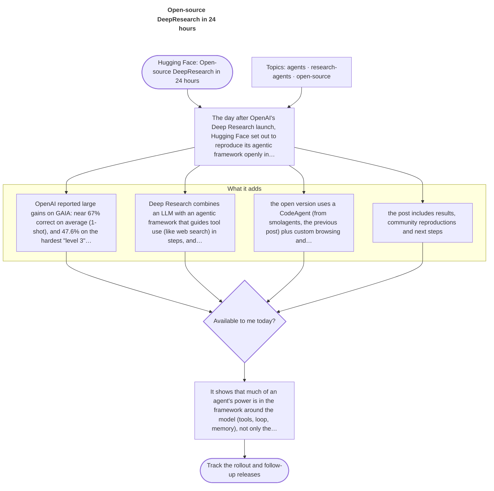

## What happened

OpenAI released **Deep Research**, a system that browses the web and answers questions from what it reads. Hugging Face's post the next day describes a **24-hour effort to reproduce it openly**.

## The technical details

From the post:

- OpenAI reported large gains on **GAIA**: near **67%** correct on average (1-shot), and **47.6%** on the hardest "level 3" questions
- Deep Research combines an LLM with an **agentic framework** that guides tool use (like web search) in steps, and OpenAI disclosed little about that framework
- the open version uses a **CodeAgent** (from smolagents, the previous post) plus custom browsing and text-inspection tools
- the post includes results, community reproductions and next steps

## How it fits together

The flowchart below maps this announcement's main points and what depends on them.

## Why it matters

It shows that much of an agent's power is in the **framework around the model** (tools, loop, memory), not only the model. Two months later, "Code as Agent Harness" (May 2026 on this blog) builds a whole survey on that idea.
